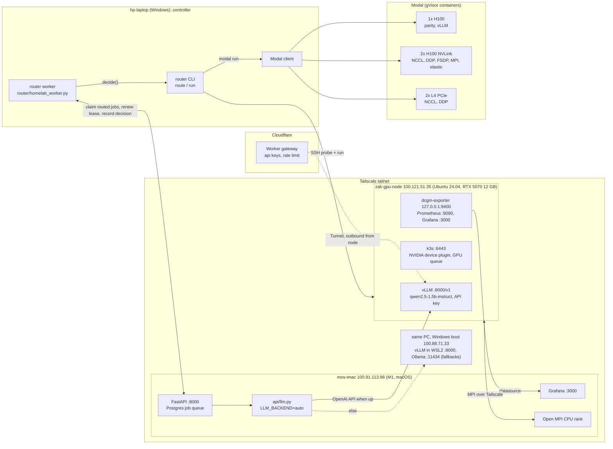

<div align="center">

# gpu-systems-lab

**GPU systems from one RTX 5070 to multi-GPU H100s: CUDA kernels, MPI/NCCL, FSDP, vLLM serving, k3s scheduling, DCGM monitoring, and a local-vs-cloud job router.**

     

[homelab](https://github.com/zakiscoding/homelab) (docs hub) · [homelab-services](https://github.com/zakiscoding/homelab-services) · [homelab-web](https://github.com/zakiscoding/homelab-web) · [homelab-gpu](https://github.com/zakiscoding/homelab-gpu) · **gpu-systems-lab**

</div>

---

This repo is the Ubuntu side of the dual-boot GPU PC (`zak-gpu-node`) plus the Modal cloud runs
that it is compared against. It also provides the homelab's always-on chat backend (vLLM) and the
router worker that runs routed jobs from the iMac job queue.

## What's inside

- **CUDA kernels:** tiled matmul, reductions, fused bias+GELU. Warp-shuffle reduction hits 641 GB/s (95% of DRAM peak).
- **Single GPU vs cloud:** RTX 5070 BF16 67.7 TFLOPS vs H100 677.8 (10x).
- **Collectives and data parallel:** NCCL all-reduce 329 GB/s on 2x H100 vs 6.65 GB/s on 2x L4. DDP 1.57x on 2x H100 at batch 4096.
- **MPI:** one node, one rank per GPU on 2x H100 (Jacobi 1.38x), and across two machines (RTX 5070 + M1 iMac over Tailscale, bit-exact).
- **Sharded training:** FSDP2 trains a 5.6B model that OOMs under DDP. Elastic restart recovers a killed rank in 11–14 s.
- **Serving and operations:** vLLM Qwen2.5-1.5B 4.4k tok/s on the RTX 5070 vs 16.8k on an H100 (concurrency 64). k3s GPU pods run at native 67.7 TFLOPS. DCGM, Prometheus and Grafana watch the card.

All results, with the code that produced them: **[docs/RESULTS.md](docs/RESULTS.md)**.

## Architecture



- The laptop never computes. It probes and dispatches: free local card when the job fits, else the cheapest Modal GPU that meets the VRAM, deadline and cost limits.
- The GPU PC runs Windows **or** Ubuntu, never both. Homelab chat goes to vLLM on either boot: natively on Ubuntu, or in WSL2 on Windows, where `zakar`'s Tailscale serves it at `100.88.71.33:8000`. Ollama on Windows is the last fallback (rechecked every 30 s).
- Node services are tailnet-only. ufw blocks 22/6443/10250 on the LAN ([scripts/harden_node.sh](scripts/harden_node.sh)). The [Cloudflare gateway](gateway/README.md) adds a keyed public path to vLLM through an outbound tunnel, with no ports opened. It currently runs from WSL2 on the Windows boot; the Ubuntu node and the Grafana route aren't set up.

## Quickstart

On the GPU node (Ubuntu), from `~/gpu-systems-lab`:

```bash
bash scripts/check_env.sh                  # read-only baseline: OS, disks, GPU, toolchain
bash scripts/setup_venv.sh                 # .venv with PyTorch cu128 (needed for sm_120)
sudo bash scripts/install_system_deps.sh   # once: CUDA 13.2, LLVM 21, Docker + NVIDIA Container Toolkit
source .venv/bin/activate
python benchmarks/smoke_test.py            # correctness checks + matmul TFLOPS sweep -> results/*.json
```

On the laptop (PowerShell, repo root, `PYTHONUTF8=1`):

```powershell
python -m modal run modal/smoke.py --gpu H100   # the same smoke test on a Modal GPU
python -m router targets                        # catalog: local card + Modal GPUs
python -m router route --job smoke              # where would it run, and why (runs nothing)
```

Modal setup and spend limits: [modal/README.md](modal/README.md).

## Tour

| Directory | What you learn | Headline result | Read |
|---|---|---|---|
| `scripts/` + `benchmarks/` | Node baseline and the shared smoke test used everywhere | RTX 5070 BF16 67.7 TFLOPS | [CODE-GUIDE](docs/CODE-GUIDE.md#scripts--node-setup-run-on-the-gpu-node) |
| `cuda/` | Hand-written kernels, PTX and LLVM IR | warp-shuffle reduction 641 GB/s (95% of peak) | [cuda/README.md](cuda/README.md) |
| `docker/` | A pinned, reproducible benchmark image | matches native within 1% | [docker/README.md](docker/README.md) |
| `modal/` | The same workloads on cloud GPUs | H100 BF16 677.8 TFLOPS (10x) | [modal/README.md](modal/README.md) |
| `mpi/` | Point-to-point, all-reduce, halo exchange; one rank per GPU | 2x H100 Jacobi 1.38x | [mpi/README.md](mpi/README.md) |
| `mpi/multinode/` | Heterogeneous MPI: RTX 5070 + M1 iMac over Tailscale | bit-exact across GPU/CPU and x86/ARM | [mpi/multinode/README.md](mpi/multinode/README.md) |
| `modal/ddp_nccl.py` | NCCL collectives and DDP scaling | 329 GB/s busbw; DDP 1.57x at batch 4096 | [modal/README.md](modal/README.md) |
| `distributed/` | FSDP2, sharded checkpoints, elastic restart | 5.6B OOM under DDP, trains under FSDP; restart in 11–14 s | [distributed/README.md](distributed/README.md) |
| `serving/` | vLLM concurrency sweep; always-on homelab chat backend | 4.4k tok/s RTX 5070 vs 16.8k H100 | [serving/README.md](serving/README.md) |
| `gateway/` + `cloudflare/` | Public vLLM API on a Cloudflare Worker, reached through a Tunnel | adds 0.2 s to 200 tokens; streaming not buffered | [gateway/README.md](gateway/README.md) |
| `site/` | Public results page with charts, built from `docs/RESULTS.md` | build refuses to publish network details | [CODE-GUIDE](docs/CODE-GUIDE.md#site--public-results-page-cloudflare-static-assets) |
| `observability/` | dcgm-exporter + Prometheus + Grafana on a GeForce card | full profiling fields on the 5070 | [observability/README.md](observability/README.md) |
| `scheduling/` | k3s GPU queue, time-slicing, admission policy | pods at native 67.7 TFLOPS | [scheduling/README.md](scheduling/README.md) |
| `router/` | Local-vs-cloud placement, homelab queue worker | picks local, L40S or 2x H100 by VRAM, deadline, cost | [router/README.md](router/README.md) |
| `docs/profiling/` | Nsight Systems profiles of the kernels | 8x gap to cuBLAS explained | [docs/profiling/README.md](docs/profiling/README.md) |

## Operations

All on the GPU node unless noted.

| Task | Command |
|---|---|
| vLLM chat backend: start (once, then restarts itself) | `cd serving && ./make-env.sh && docker compose up -d` |
| vLLM: free the GPU for a big job | `cd serving && docker compose stop` |
| Monitoring: start / check | `cd observability && docker compose up -d && ./verify.sh` |
| Monitoring: URLs | Grafana `http://100.121.51.35:3000`, Prometheus `http://100.121.51.35:9090` |
| k3s: GPU allocatable? | `kubectl get node zak-gpu-node -o jsonpath='{.status.allocatable.nvidia\.com/gpu}'` (expect `1`) |
| k3s: submit a GPU job | `cd scheduling && python3 submit.py --name mm --env DURATION=20 --configmap gpu-bench:/bench -- python /bench/bench.py` |
| Router worker (laptop) | `python -m router.homelab_worker` (config in `router/worker.local.env`, gitignored) |
| Router tests (laptop) | `python -m unittest router.test_route` |

## Roadmap

### 0. Safety and identity baseline
- Confirm Ubuntu runs from the external 750 GB drive (shows as 698 GB).
- Keep the internal Windows NVMe untouched and unmounted in Ubuntu.
- Verify `nvidia-smi`, GPU visibility, disk mounts, hostname, and Tailscale identity before remote control-plane work.

### 1. Local RTX 5070 baseline
- Create an isolated Python environment.
- Install a PyTorch CUDA wheel compatible with the installed NVIDIA driver.
- Run tensor, matmul, and mixed-precision benchmarks.
- Record GPU model, driver, CUDA runtime, timing, VRAM use, and throughput.

### 2. CUDA and LLVM foundations
- Implement small CUDA C++ kernels: vector add, tiled matrix multiplication, reductions, and fused operations.
- Profile with Nsight Systems/Compute when useful.
- Use LLVM/Clang tooling to inspect compilation, IR, and optimization choices.

### 3. Reproducible GPU containers
- Add Docker plus NVIDIA Container Toolkit after native workloads pass.
- Package a benchmark image and pin Python/package versions.
- Document build, run, and validation commands.

### 4. Modal parity
- Run the same benchmark and training workload on Modal.
- Compare local versus cloud performance, startup time, GPU memory, and estimated cost.

### 5. Distributed training: NCCL first, MPI second
- Use PyTorch `torchrun` + DDP on Modal for multi-GPU training.
- Validate NCCL collectives and scaling with 2+ GPUs.
- Add MPI only for experiments where its process-launch and communication model is the point; it is not required for normal PyTorch DDP.

### 6. Portfolio deliverables
- Publish benchmark results, architecture notes, profiling screenshots, and reproducible runbooks.
- Build a small job-router/control-plane demo that chooses local RTX versus Modal based on VRAM, queue time, and cost.

### Principles
- Start locally; use Modal only when multi-GPU capacity is genuinely needed.
- Do not install the full CUDA Toolkit unless a C++/custom-kernel task requires it.
- Keep local hardware, cloud configuration, secrets, and generated artifacts out of Git.
- Make every experiment reproducible and measurable.

## Status

| Done | Item | Result |
|:---:|---|---|
| [x] | Ubuntu 24.04.5 on the external 750 GB drive | RTX 5070 recognized by the NVIDIA driver and `nvidia-smi` |
| [x] | Local PyTorch CUDA smoke test | torch 2.11.0+cu128; BF16 67.7 / FP16 64.1 / TF32 33.8 / FP32 23.7 TFLOPS at 8192², H2D 44 GiB/s |
| [x] | System deps (`sudo bash scripts/install_system_deps.sh`) | CUDA 13.2 toolkit, LLVM 21, Docker + NVIDIA Container Toolkit |
| [x] | CUDA kernels + PTX/LLVM IR inspection (`cuda/`) | vector add, tiled matmul vs cuBLAS, reductions, fused bias+GELU |
| [x] | MPI on one node (`mpi/`) | ping-pong, all-reduce, Jacobi halo exchange; MPS gives 3x on shared-GPU runs |
| [x] | MPI one rank per GPU on Modal (`modal/mpi_multigpu.py`) | 2x H100, Jacobi 1.38x faster, halo staged via host |
| [x] | CUDA-aware Open MPI on 2x H100 (`--cuda-aware`) | 324 GB/s point-to-point, but collectives slower in the sandbox |
| [x] | Multi-GPU NCCL run | 2x H100: all-reduce 329 GB/s busbw; DDP 1.02x at batch 256, 1.57x at batch 4096 |
| [x] | MPI across two machines (`mpi/multinode/`) | RTX 5070 + M1 iMac over Tailscale; GPU and CPU results bit-exact, network-bound |
| [x] | Containerized benchmark (`docker/`) | pinned cu128 image, `run.sh validate`; matches native within 1% |
| [x] | Modal parity run | H100: BF16 677.8 TFLOPS, 10x the RTX 5070; cold start 3.7 s |
| [x] | Portfolio write-up and profiles | [docs/RESULTS.md](docs/RESULTS.md), Nsight Systems in [docs/profiling/](docs/profiling/README.md) |
| [x] | Job router (`router/`) | local RTX vs Modal by VRAM, deadline, cost, NVLink; 10 unit tests |
| [x] | Router connected to the homelab job queue | `router/homelab_worker.py` claims routed jobs and renews their lease every 5 min |
| [x] | Inference serving (`serving/`) | vLLM 0.32, Qwen2.5-1.5B 4.4k tok/s on RTX 5070 vs 16.8k on H100 at concurrency 64 |
| [x] | Always-on homelab chat backend (`serving/compose.yml`) | vLLM on tailnet `:8000/v1` with an API key; iMac API uses it via `LLM_BACKEND=auto` |
| [x] | Sharded training (`distributed/`) | FSDP2 halves per-GPU state; 5.6B model OOMs under DDP, trains under FSDP on 2x H100 |
| [x] | Fault tolerance | torchrun restarts + DCP checkpoints: killed rank recovered in 11-14 s, bit-identical final loss |
| [x] | Observability (`observability/`) | dcgm-exporter + Prometheus + Grafana on the node, tailnet-only |
| [x] | Scheduling (`scheduling/`) | k3s + NVIDIA device plugin; GPU jobs queue one at a time at native 67.5 TFLOPS; time-slicing gives no gain on a saturated GPU |
| [x] | Node hardening (`scripts/harden_node.sh`) | ufw blocks 22/6443/10250 on the LAN; GPU admission policy closes the queue bypass |
| [ ] | Nsight Compute counters | needs `NVreg_RestrictProfilingToAdminUsers=0` on the node |

## Docs

| Doc | What it holds |
|---|---|
| [docs/RESULTS.md](docs/RESULTS.md) | Every measured number, the architecture, conclusions, runbook index |
| [docs/CODE-GUIDE.md](docs/CODE-GUIDE.md) | File-by-file map: what each file does, where it runs, how the parts connect |
| [docs/CLOUDFLARE.md](docs/CLOUDFLARE.md) | The Cloudflare gateway, tunnel, fallback and results site: status, decisions, test results and how to run them |
| [docs/profiling/README.md](docs/profiling/README.md) | Nsight Systems profiles of the CUDA kernels; why Nsight Compute is blocked |
| [router/README.md](router/README.md) | How the router decides, and the homelab queue integration |

## Related repos

| Repo | Role | Touch points with this repo |
|---|---|---|
| [homelab](https://github.com/zakiscoding/homelab) | Docs hub: architecture, nodes, services, setup log, runbooks | `docs/nodes/gpu-node-ubuntu.md` describes this node |
| [homelab-services](https://github.com/zakiscoding/homelab-services) | iMac stack: FastAPI, Postgres job queue, Redis, Qdrant RAG, Prometheus/Grafana, MLflow | `api/llm.py` calls `serving/`'s vLLM; routed jobs go to `router/homelab_worker.py`; its Grafana shows `observability/` |
| [homelab-web](https://github.com/zakiscoding/homelab-web) | Next.js UI on the iMac (:3081): chat, RAG, status | its chat answers come from vLLM here when the PC runs Ubuntu |
| [homelab-gpu](https://github.com/zakiscoding/homelab-gpu) | Same PC booted into Windows: Ollama, QLoRA training, GPU job worker | Ollama is the chat fallback; its worker skips routed jobs |
