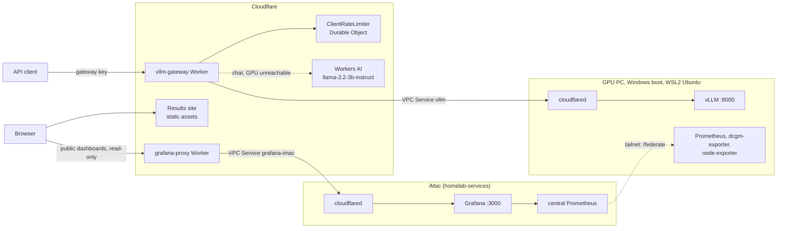

# Cloudflare in gpu-systems-lab

[homelab](https://github.com/zakiscoding/homelab) (docs hub) · [homelab-services](https://github.com/zakiscoding/homelab-services) · [homelab-web](https://github.com/zakiscoding/homelab-web) · [homelab-gpu](https://github.com/zakiscoding/homelab-gpu) · **gpu-systems-lab**

[gpu-systems-lab](../README.md) / `docs/CLOUDFLARE.md` · [← repo README](../README.md) · [Results](RESULTS.md) · [Code guide](CODE-GUIDE.md)

What was added on November 4–5, 2026, why, what was tested, and how to run it. The work was
merged into `main` on November 5 in [pull request #1](https://github.com/zakiscoding/gpu-systems-lab/pull/1).
Setup details live in [gateway/README.md](../gateway/README.md) and [cloudflare/README.md](../cloudflare/README.md).

## Status

Checked on November 5, 2026.

| Piece | State | Address or location |
|---|---|---|
| LLM gateway | Live, answering from the GPU | https://vllm-gateway.vllm-gateway.workers.dev |
| Workers AI fallback | Live | Same address, used when the GPU is unreachable |
| Results site | Live and public | https://gpu-systems-lab-results.vllm-gateway.workers.dev |
| Tunnel `gpu-pc` | Healthy | `cloudflared` in WSL2 on the GPU PC |
| vLLM | Running | WSL2 on the Windows boot, `127.0.0.1:8000`, forwarded to the tailnet at `100.88.71.33:8000` |
| Monitoring stack | Running | WSL2; Prometheus and Grafana forwarded to the tailnet at `100.88.71.33:9090` and `:3000` |
| Public dashboards | Live and public, read-only | https://grafana-proxy.vllm-gateway.workers.dev: four dashboards from the homelab's central Grafana on the iMac |
| Tunnel `mos-imac` | Healthy | `cloudflared` in `homelab-services` on the iMac, for Grafana only |
| R2 storage | **Not set up**: R2 isn't enabled on the account | [scripts/sync_results_r2.sh](../scripts/sync_results_r2.sh) is ready |
| Custom domain | **Not set up** | Everything uses `workers.dev` |
| Ubuntu boot | **Not set up or tested** | Steps are in [cloudflare/README.md](../cloudflare/README.md#ubuntu-boot) |
| Pull request #1 | Merged on November 5 | Merge commit `744eb6c` |

## Architecture



`cloudflared` only makes outbound connections, so no router ports are open. vLLM and Grafana have no public
hostnames. The Workers reach them through [Workers VPC](https://developers.cloudflare.com/workers-vpc/) Services,
each limited to one host and port. The tailnet paths described in the rest of the repo aren't changed.

## Cloudflare components

| Component | Name | Purpose | Defined in |
|---|---|---|---|
| Workers | `vllm-gateway` | Public OpenAI-compatible API | [gateway/src/index.js](../gateway/src/index.js) |
| Workers | `grafana-proxy` | Public read-only dashboards from the iMac's Grafana | [grafana-proxy/src/index.js](../grafana-proxy/src/index.js) |
| Workers static assets | `gpu-systems-lab-results` | Public results page | [site/](../site/build.mjs) |
| Tunnel | `gpu-pc` | Outbound link from the GPU PC | [cloudflare/compose.yml](../cloudflare/compose.yml) |
| Tunnel | `mos-imac` | Outbound link from the iMac, to its Grafana | `cloudflare/compose.yml` in homelab-services |
| Workers VPC (beta) | `vllm`, `grafana` | Private routes from Workers to the tunnel | `wrangler.jsonc` in each Worker |
| Durable Objects | `ClientRateLimiter` | Strict per-client rate limit | [gateway/src/index.js](../gateway/src/index.js) |
| Workers AI | `@cf/meta/llama-3.2-3b-instruct` | Chat fallback | [gateway/wrangler.jsonc](../gateway/wrangler.jsonc) |
| Secrets | `VLLM_API_KEY`, `GATEWAY_KEYS` | vLLM's key and the hashes of client keys | `wrangler secret put` |

Planned but not active: **R2** for raw results and a **custom domain**.

## What the gateway does

| Case | Result |
|---|---|
| Routes | Chat, completions and models, plus a public `/health`. Everything else is 404, so other vLLM endpoints stay private |
| Bad or missing key | 401. Client keys are stored only as SHA-256 hashes |
| Over 60 requests in any 60 s | 429 with `Retry-After`, per client |
| Limiter unavailable | 503: requests are refused rather than let through unlimited |
| Body over 256 KiB, or not a JSON object | 413, or 400 |
| `max_tokens` | Clamped to 1024 |
| GPU unreachable, chat | Answered by Workers AI |
| GPU unreachable, anything else | 503. This includes chat using `tools`, `functions` or `response_format` |
| Which backend answered | The `x-gateway-backend` header is `gpu` or `workers-ai` |
| Logs | Client name, route, status and latency, never prompts, completions or keys |

## Running on the GPU PC

The Ubuntu boot (`zak-gpu-node`) was offline, and the PC was only reachable on its Windows boot (`zak-ts`), so
everything runs in Ubuntu 26.04 on WSL2. That distro was empty and now has:

- Docker, Docker Compose and the NVIDIA container toolkit
- `Qwen/Qwen2.5-1.5B-Instruct` weights in `/root/.cache/huggingface`
- `serving/`, `observability/` and `cloudflare/` in `/root/gpu-systems-lab`, started with their `compose.wsl.yml` overrides
- New `.env` files for each stack: mode 600, not in Git, and values that differ from the Ubuntu node's

The overrides exist because WSL has no tailnet IP, so ports are published on `127.0.0.1`. Windows forwards its
localhost into WSL, and `zakar`'s Windows Tailscale serves those ports to the tailnet only:

```powershell
# on zakar; settings persist across reboots
tailscale serve --bg --tcp 8000 tcp://127.0.0.1:8000   # vLLM
tailscale serve --bg --tcp 9090 tcp://127.0.0.1:9090   # Prometheus
tailscale serve --bg --tcp 3000 tcp://127.0.0.1:3000   # Grafana
tailscale serve status                                 # to undo: tailscale serve --tcp=<port> off
```

The iMac API reaches this vLLM through `LLM_FALLBACK_URL=http://100.88.71.33:8000/v1` (see
[serving/README.md](../serving/README.md#homelab-chat-backend-always-on)). I tried running Tailscale inside WSL as its own
node instead, but forwarding from `zakar` needs no extra machine or login.

**Keep-alive task.** WSL stops seconds after its last session closes, even with containers running. The Windows
scheduled task `WSL Keep Alive` holds a session open with `wsl.exe -d Ubuntu --exec sleep infinity`. It runs at
startup as `zakar`, with S4U logon so no password is stored. `C:\Users\zakar\.wslconfig` also sets
`vmIdleTimeout=-1`.

Starting only at boot wasn't enough. On 2026-11-04 the task's session ended with exit code 1, probably from a WSL
shutdown or update. The PC hadn't rebooted since 2026-10-27, so nothing started the task again, and vLLM, the tunnel and
monitoring were down for 9 days. The task now has a second trigger that runs every 5 minutes with
`MultipleInstances=IgnoreNew`, so it does nothing while the session is alive and restarts it within 5 minutes after one
ends.

To remove it, run this in an elevated PowerShell, then `wsl.exe --terminate Ubuntu`:

```powershell
Unregister-ScheduledTask -TaskName 'WSL Keep Alive' -Confirm:$false
```

GPU memory in use is about 8.2 of 12.2 GB, including what Windows itself uses.

## Test results

Measured against the deployed Workers, with vLLM and the tunnel in WSL2 on the RTX 5070.

| Check | Result |
|---|---|
| Unit tests | 31 in `gateway/`, 11 in `grafana-proxy/`, all passing |
| Added latency | 200 tokens: 1.31 s direct, 1.53 s through the gateway |
| Streaming | 400 tokens arrived in over 440 chunks, median gap 5–6 ms, not buffered |
| Official OpenAI SDK (Node, v7) | Chat, streaming and error types work on the GPU and the fallback |
| Auth | No key or a wrong key gets 401; an unlisted path gets 404 |
| Rate limit, 300 requests at once | Exactly 60 allowed, 240 refused; capacity came back after the `Retry-After` wait |
| Tunnel or vLLM stopped | Chat moved to Workers AI, and returned to the GPU by itself after restart (vLLM reload 55 s) |
| Worker CPU time | 0–2 ms per request, on short requests |
| Prompts in Worker logs | None found |
| Keep-alive | WSL stayed up for about 12 hours with no other session. Containers stayed up after the SSH session that started them closed |
| Tailnet access to WSL | From the laptop and the iMac: vLLM `/health` 200, Prometheus 200 with all targets up, Grafana 200 |
| iMac chat on the Windows boot | `auto` chose `100.88.71.33:8000`; a one-line reply from `qwen2.5-1.5b-instruct` took 0.4 s |
| Monitoring in WSL | `dcgm-exporter` reports 22 GPU series, and all Prometheus targets are up |
| Public dashboards (2026-11-13) | All four load with live data in a browser through the Worker. `/login`, `/d/<uid>`, `/explore`, `/api/health`, `/api/datasources`, `/api/ds/query` and unlisted dashboard tokens all get 404; no `Set-Cookie` comes back |
| Grafana restarting | The link answers 503 with a plain message, then recovers by itself |
| Results site | No IPs, machine names or GitHub links on the live page; source files return 404 |

**Not tested:**

- WSL and the stacks starting by themselves after a Windows reboot
- The 5-minute trigger restarting the keep-alive after its session ends
- Grafana's live updates over WebSocket through the proxy
- Connecting with the old tunnel token (Cloudflare documents that it can't start new connections)
- Workers AI running out of quota, which is covered by unit tests only
- Requests over 125 s: the longest allowed completion took 7 s when idle
- Worker CPU time on long streams
- The R2 script, beyond its dry run
- The Ubuntu boot steps

## Decisions

| Decision | Why |
|---|---|
| A Worker plus a tunnel, not a public hostname for vLLM | Key checks, rate limits and a route allowlist sit in front of vLLM, with no public origin to attack |
| Workers VPC instead of Access service tokens | No public vLLM hostname at all. It's in beta, so service tokens remain the documented fallback |
| Run in WSL2 | The Ubuntu boot was offline, and rebooting remotely risked losing the PC with no one there to fix it |
| `workers.dev` instead of a domain | No domain is available yet, and Access can protect `workers.dev` directly |
| Durable Object rate limit | Cloudflare's Rate Limiting binding allowed 300 of 300 concurrent requests |
| Limiter fails closed | It's what protects the GPU from a runaway client |
| Fallback for chat only, without `tools` | A clear 503 is better than a wrong answer from a model that ignored those fields |
| `llama-3.2-3b-instruct` for the fallback | Cheap, no reasoning overhead, listed as zero data retention |
| Results site drops the architecture map and runbooks | They map the home network, and its links are relative paths that only work inside the repo |
| Site build fails on IPs and machine names | A later change to `RESULTS.md` can't publish them by accident |
| Charts read from the doc's tables | They can't drift from the numbers beside them |
| Public dashboards instead of an Access login for Grafana | The dashboards are meant to be linked from anywhere. Grafana's public-dashboard links run only each dashboard's saved queries, and the Worker forwards nothing else, so the admin UI, API and Explore stay unreachable |
| Grafana from the iMac, not the GPU PC | The iMac is always on and its Prometheus scrapes every node, including both boots of the GPU PC |

## What went wrong

| Issue | Outcome |
|---|---|
| The tunnel token was pasted into chat | Rotated through the API without displaying the new one, and all connections were dropped. The old token is in the chat history, not in Git |
| The first streaming test looked slow, about 10 s for 60 tokens | A shell loop was timestamping lines as it processed them. A script timing each network chunk showed streaming was fine, and the earlier "token by token" claim was corrected |
| The Rate Limiting binding didn't stop bursts | Replaced with a Durable Object |
| Wrangler deployed the site differently than asked | It used a Worker with static assets, not classic Pages, and removed the build step from `npm run deploy`, which would have skipped the safety check. The build step and the pinned version were restored |
| A rate limit deploy went out with 3 failing unit tests | The command didn't stop on failure. The bug was in the tests, and they pass now. `grafana-proxy` and `site` now run their check before deploying; `gateway` doesn't yet |
| The Rate Limiting binding failed in the local simulator | Never explained, and no longer relevant now the binding is gone |
| Automated browser focus tests reported tooltips as broken | The preview pane had no window focus. Direct events and a real mouse hover worked |
| Copilot couldn't review pull request #1 | Its requester was out of quota, so it has had no automated review |

## Limits

- **Rate limit:** it counts requests, not tokens, so 60 long requests at once are still allowed.
- **Privacy:** Cloudflare terminates TLS, so prompts pass through it decrypted. During fallback, a Cloudflare-hosted model handles them.
- **Cost:** Workers AI includes 10,000 Neurons a day, and a 44-token exchange used about 0.3. Beyond that, the Free plan returns errors and Workers Paid bills $0.011 per 1,000 Neurons. The account's plan hasn't been confirmed.
- **Workers VPC is in beta:** its APIs may change.
- **Which boot:** the GPU path only works on the boot where vLLM and the tunnel are running, which today is Windows. On the Ubuntu boot, chat falls back to Workers AI until they're set up there.
- **Long requests:** Cloudflare documents a 125 s proxy read timeout below Enterprise, so long completions should stream.

## Common tasks

Run Wrangler commands from the Worker's folder on the laptop, after `npx wrangler login`.

**Use the gateway.** Point any OpenAI-compatible client at `https://vllm-gateway.vllm-gateway.workers.dev/v1`.
The laptop's key is in `gateway/.client-key`, which is gitignored.

**Add a client.** Run `./make-key.sh <name>` in `gateway/`, then add the entry it prints to the comma-separated
`GATEWAY_KEYS` with `npx wrangler secret put GATEWAY_KEYS`. The secret's current value can't be read back, so keep your
own list of entries. To revoke a client, set the secret again without that entry.

**Deploy:**

```bash
cd gateway && npm test && npx wrangler deploy
```

```bash
cd site && npm run deploy
```

```bash
cd grafana-proxy && npm run deploy
```

**Rotate the tunnel token.** Refresh it in the dashboard, put the new one in `cloudflare/.env` on the GPU PC, and
run the command below. Don't paste tokens into chat.

```bash
docker compose -f compose.yml -f compose.wsl.yml up -d --force-recreate
```

**Check that everything is up:**

```bash
ssh zak-ts "wsl.exe -d Ubuntu -- docker ps"
```

**Take the public paths offline.** In `cloudflare/` on the GPU PC, run the command below. The Workers stay deployed:
chat moves to Workers AI, and everything else gets a 503.

```bash
docker compose -f compose.yml -f compose.wsl.yml down
```

## What's left

| Task | Who | Needs |
|---|---|---|
| Enable R2, then create the bucket and upload the 48 result files | You, then Claude | A dashboard step, which may ask for a payment method |
| Test a reboot | You | Being at the GPU PC |
| Set up the Ubuntu boot | You | Being at the GPU PC, and a fresh tunnel token from the dashboard |
| Add a custom domain | You, then Claude | Buying or adding a domain |
