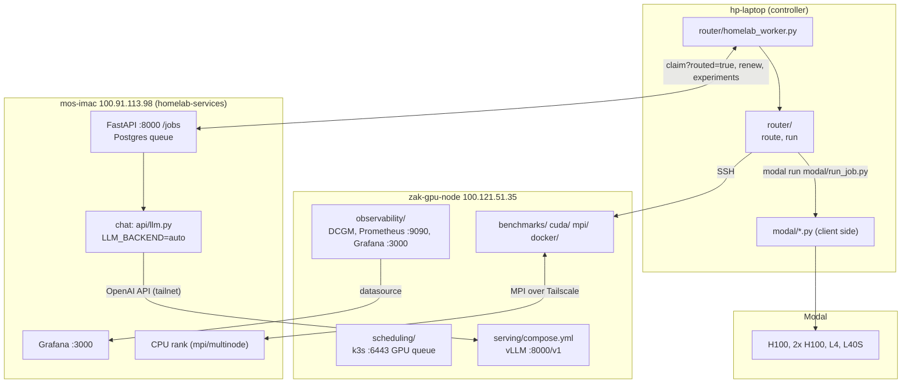

# Code guide

[homelab](https://github.com/zakiscoding/homelab) (docs hub) · [homelab-services](https://github.com/zakiscoding/homelab-services) · [homelab-web](https://github.com/zakiscoding/homelab-web) · [homelab-gpu](https://github.com/zakiscoding/homelab-gpu) · **gpu-systems-lab**

[gpu-systems-lab](../README.md) / `docs/CODE-GUIDE.md` · [← repo README](../README.md) · [Results](RESULTS.md)

A map of every part of this repo: what each file is for, how to run it, where it runs, and how
the pieces connect to each other and to the rest of the homelab. Results live in
[RESULTS.md](RESULTS.md); each directory's README has the details and measured numbers.

## Where code runs

| Machine | Role | Reached as |
|---|---|---|
| **Laptop** (Windows, `hp-laptop`) | Edits the repo, orchestrates: SSH to the node, `modal run`, router worker | — |
| **GPU node** (`zak-gpu-node`, Ubuntu 24.04, RTX 5070 12 GB) | CUDA, MPI, Docker, k3s, vLLM, monitoring | `ssh gpu-ts` (Tailscale SSH), `100.121.51.35` |
| **iMac** (`mos-imac`, M1) | homelab control plane (API, Postgres, web UI); CPU rank for 2-machine MPI | `ssh imac-ts`, `100.91.113.98` |
| **Modal** (cloud) | H100 / 2x H100 / L4 runs: parity, NCCL, FSDP, MPI, vLLM | `python -m modal run modal/<script>.py` |

The repo is edited on the laptop and copied to `~/gpu-systems-lab` on the node (tar over SSH,
stripping CRLF). Modal scripts mount the repo directories they need into the container.

## How the pieces connect

When the GPU PC is booted into Windows instead, `api/llm.py` uses the vLLM copy in WSL2, which `zakar`'s
Tailscale serves at `100.88.71.33:8000` (`LLM_FALLBACK_URL`). If that doesn't answer either, it falls back to Ollama
(`100.88.71.33:11434`, [homelab-gpu](https://github.com/zakiscoding/homelab-gpu)).

## Directory by directory

### `scripts/` — node setup (run on the GPU node)

| File | Purpose |
|---|---|
| `check_env.sh` | Read-only baseline: OS, disks (Windows NVMe must stay unmounted), GPU, toolchain. `ssh gpu-ts 'bash -s' < scripts/check_env.sh` |
| `setup_venv.sh` | Creates `.venv` with PyTorch for CUDA 12.8 (needed for sm_120) |
| `install_system_deps.sh` | One-time root install: CUDA 13.2 toolkit, LLVM 21, Docker + NVIDIA Container Toolkit |
| `harden_node.sh` | Owner-run hardening: LAN firewall for 22/6443/10250, Nsight counters, sudo cleanup |
| `sync_results_r2.sh` | Laptop, not the node: copies raw `results/` to a private R2 bucket (`--dry-run` lists the files) |

### `benchmarks/` — the shared yardstick

`smoke_test.py` runs correctness checks (matmul vs CPU, reduction, bf16 autocast), a matmul TFLOPS
sweep across FP32, TF32, FP16 and BF16, and host-to-device bandwidth. It writes a JSON record to
`results/`. The same script runs natively, in Docker, under k3s, on Modal (`modal/smoke.py`) and
through the router, so every number in the repo is comparable.

### `cuda/` — hand-written kernels (Makefile, nvcc + clang-21)

| File | Teaches |
|---|---|
| `common.cuh` | `CUDA_CHECK`, cudaEvent timer, deterministic fill, error and table helpers |
| `vector_add.cu` | grid-stride loop, `float4` vector loads, memory-bound peak |
| `matmul.cu` | naive vs shared-memory tiled (16/32) vs cuBLAS; why tiling alone is ~8x off cuBLAS |
| `reduction.cu` | atomic vs shared-memory tree vs warp shuffle vs CUB |
| `fused.cu` | kernel fusion (bias + GELU), halving DRAM traffic |

`make run` benchmarks every kernel, `make ptx` emits PTX, and `make llvm` emits LLVM IR and PTX via clang-21.

### `mpi/` — MPI on one node (Open MPI 4.1.6)

| File | Purpose |
|---|---|
| `mpi_common.cuh` | `MPI_CHECK`, CUDA-awareness detection, `bind_local_gpu()` (one GPU per rank), busbw formula |
| `pingpong.cu` | Latency and bandwidth, host vs GPU-staged vs CUDA-aware direct |
| `allreduce.cu` | `MPI_Allreduce` sweep reported in the nccl-tests algbw/busbw convention |
| `jacobi.cu` | 2D heat diffusion with halo exchange, checked bit-exact against a serial run |
| `multinode/` | The same ideas across two machines (RTX node + M1 iMac): `netbench.cpp`, `jacobi_hetero.cpp` (GPU on Linux, CPU on macOS) |

### `modal/` — cloud GPU runs (laptop: `python -m modal run modal/<file>.py`)

| File | What runs remotely |
|---|---|
| `smoke.py` | `benchmarks/smoke_test.py` on any single GPU (parity vs the RTX 5070) |
| `ddp_nccl.py` + `ddp_train.py` | NCCL all-reduce sweep and DDP scaling, 1 vs N GPUs |
| `fsdp_train.py` + `fsdp_gpt.py` | DDP vs FSDP2 memory and throughput, sharded checkpoint and resume (GPT decoder) |
| `elastic_train.py` | `torchrun --max-restarts` with a killed rank, recovering from a checkpoint |
| `mpi_multigpu.py` | Builds `mpi/` in a 2-GPU container. Stock or `--cuda-aware` (Open MPI built from source in a 16-core build step) |
| `serve_vllm.py` | vLLM concurrency benchmark on an H100 |
| `run_job.py` | Generic "run this repo command on GPU X". The router's cloud executor |
| `compare.py` | Local only: tables across `results/*.json` (local vs Modal, approximate $) |

Spend is capped by Modal's $10 usage limit. Windows needs `PYTHONUTF8=1`.

### `docker/` — reproducible benchmark image

`Dockerfile` (CUDA 12.8 base pinned by digest, torch 2.11 cu128, non-root) and
`requirements.lock.txt`. `run.sh` wraps build, run, validate and shell.

### `serving/` — vLLM

| File | Purpose |
|---|---|
| `setup_node.sh` / `launch_server.sh` | venv-based vLLM for interactive runs and benchmarks (localhost by default) |
| `bench_sweep.py` | `vllm bench serve` at concurrency 1–256: throughput, TTFT, TPOT, KV cache |
| `compose.yml` + `make-env.sh` | **Always-on chat backend** for the homelab (tailnet `:8000`, API key, 0.45 of VRAM) |

### `gateway/` — public vLLM API (Cloudflare Worker)

| File | Purpose |
|---|---|
| `src/index.js` | Worker: client key auth, per-client rate limit (Durable Object), body and token caps, streaming passthrough to vLLM, Workers AI fallback for chat when the GPU is unreachable |
| `test/gateway.test.js` | Unit tests with a stubbed binding and rate limiter (`npm test`) |
| `wrangler.jsonc` | VPC Service, Workers AI and Durable Object bindings, fallback model, limits |
| `make-key.sh` | Creates a client key and its hashed `GATEWAY_KEYS` entry |

### `cloudflare/` — tunnel connector (Docker Compose)

`compose.yml` runs `cloudflared` on the `serving` and `observability` Docker networks, with no published ports.
It carries the gateway's private path to vLLM. `compose.wsl.yml`
limits it to `serving` for WSL2 on the Windows boot, which is where it runs today.

### `grafana-proxy/` — public, read-only dashboards (Worker)

`src/index.js` serves a landing page and forwards only the Grafana public dashboards listed in `PUBLIC_DASHBOARDS`, plus
Grafana's static files, through a VPC Service to the iMac's Grafana. Everything else is a 404, and cookies and credentials
are dropped both ways. `test/proxy.test.js` covers the allowlist, unlisted tokens, methods, body limits and headers.

### `site/` — public results page (Cloudflare static assets)

`build.mjs` turns `docs/RESULTS.md` into one static page. It drops the architecture map and runbooks, which map the home
network, turns relative repo links into text, and refuses to build if an IP, machine name or GitHub link survives.
It reads the chart data from the doc's own tables, and fails if a table or number is missing. `charts.client.js` draws
the charts in the browser at the real page width. `npm run deploy` builds and publishes.

### `distributed/`

`README.md` only. It holds the FSDP, checkpoint and elastic-restart results. The code lives in `modal/fsdp_*.py` and `modal/elastic_train.py`.

### `observability/` — GPU monitoring (Docker Compose on the node)

`docker-compose.yml` runs dcgm-exporter (`dcgm/counters.csv` selects the fields), Prometheus
(`prometheus/prometheus.yml` and `alerts.yml`), Grafana (provisioned datasource and the 21-panel
`gpu-node.json` dashboard) and node-exporter. `verify.sh` checks the whole stack end to end.

### `scheduling/` — k3s GPU scheduling

`manifests/` holds the namespace, runtime class, device plugin (exclusive and time-sliced configs), test pod,
benchmark Job, and the admission policy that requires a GPU limit. `submit.py` turns a job spec into a
Kubernetes Job and waits on it. `demo/` reproduces the queue and time-slicing experiments.

`gpu-operator/` is the prepared (not yet applied) move to the NVIDIA GPU Operator with time-slicing:
chart values, the time-slicing ConfigMap, a migration and rollback runbook, and `validate.sh`
(chart key check, `helm template`, kubeconform, all in containers).

### `operator/` — GpuJob operator (Go, controller-runtime)

| File | Role |
|---|---|
| `api/v1alpha1/gpujob_types.go` | `GpuJob` CRD: spec (image, command, gpus, cpu/memory, backoff, deadline, TTL), status, validation and printer-column markers |
| `internal/controller/jobbuilder.go` | `BuildJob()`: GpuJob to batch/v1 Job (nvidia runtime class, GPU limit, labels, spec hash) |
| `internal/controller/gpujob_controller.go` | Reconcile loop: create-or-get the Job, map Job and pod status to phase and conditions |
| `internal/controller/*_test.go` | Unit tests and envtest controller tests (real kube-apiserver and etcd) |
| `config/` | Generated CRD and RBAC, Deployment, kustomize entry point, samples |
| `hack/in-docker.sh`, `hack/kind/` | Run make targets in `golang:1.26`; the kind demo with a fake GPU |

### `router/` — local-vs-cloud control plane (laptop)

| File | Role |
|---|---|
| `catalog.py` | Targets (local card + Modal GPUs): VRAM, BF16 TFLOPS (measured overrides estimates from `results/`), $/h, queue, NVLink |
| `probe.py` | Live SSH probe of the node: util (peak of 3 samples), free VRAM, CUDA processes. Resident vLLM counts as background load, not busy |
| `route.py` | `decide()`: feasibility (VRAM headroom, GPU count, NVLink, deadline, cost), then free local first, else cheapest, else fastest |
| `jobs.py` | Named example jobs |
| `__main__.py` | CLI: `targets`, `route`, `run` (`build_command()` is shared with the worker) |
| `homelab_worker.py` | Claims routed jobs from the iMac API, decides, runs, records the decision |
| `test_route.py` | 10 unit tests (no SSH or Modal) |

## Related repos

| Repo | What it holds | Touch points with this repo |
|---|---|---|
| [homelab-services](https://github.com/zakiscoding/homelab-services) | iMac stack: FastAPI, Postgres job queue, RAG, web UI, Grafana. See its `docs/API.md` | `api/llm.py` uses `serving/compose.yml`; `claim?routed=true` serves `router/homelab_worker.py`; its Grafana shows `observability/` |
| [homelab](https://github.com/zakiscoding/homelab) | Docs: nodes, services, setup log | `docs/nodes/gpu-node-ubuntu.md` describes this node |
| [homelab-web](https://github.com/zakiscoding/homelab-web) | Next.js UI on the iMac (:3081): chat, RAG, status | Its chat answers come from `serving/` vLLM when the PC runs Ubuntu |
| [homelab-gpu](https://github.com/zakiscoding/homelab-gpu) | Windows-side Ollama, QLoRA training and the worker | Ollama is the chat fallback; its worker skips routed jobs; runs only when the PC boots Windows |

## Conventions

- **Every benchmark checks correctness** before reporting speed, and exits non-zero on mismatch.
- **Raw results go to `results/`** (gitignored). The numbers worth keeping go into READMEs and `docs/RESULTS.md`.
- **Secrets never enter git.** API keys live in `serving/.env`, `observability/.env` and
  `router/worker.local.env` (all gitignored). Each has a matching `*.example`/`make-env.sh` or doc.
- **Pinned versions:** container images by tag or digest, Python wheels by version.
- **Commits are authored as zakiscoding** with no AI co-author lines.
