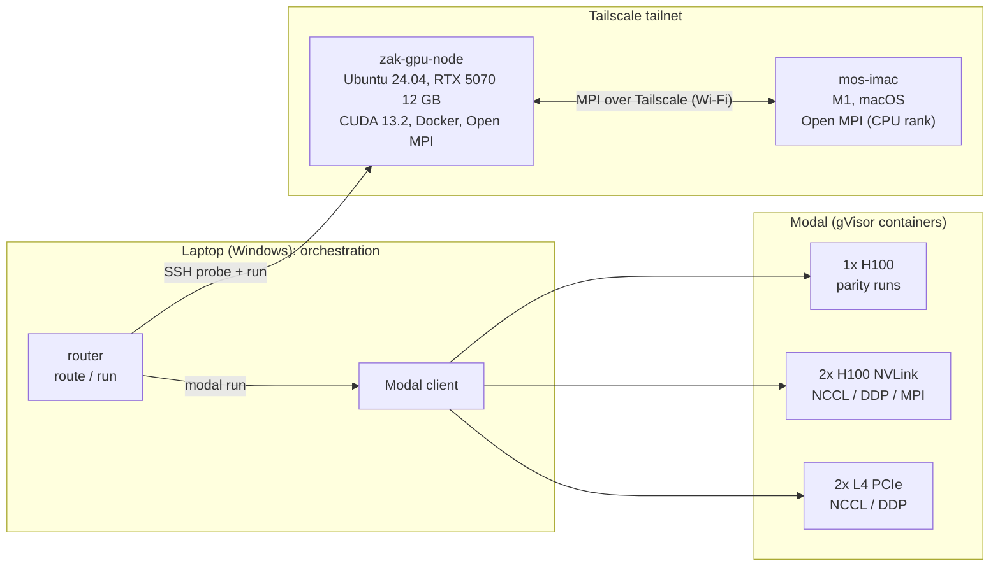

# GPU Systems Lab: results

Everything measured in this repo, from one RTX 5070 up to multi-GPU H100s on Modal and two-machine
MPI over Tailscale. Every number links to the code and runbook that produced it.

## Architecture

The laptop never computes. It probes and dispatches. `router/` sends a job to the free local card
when it fits, and otherwise to the cheapest Modal GPU that meets the VRAM, deadline and cost limits.

## Headline numbers

### Single GPU: RTX 5070 vs H100 ([benchmarks/](../benchmarks/), [modal/smoke.py](../modal/smoke.py))

| 8192² matmul | RTX 5070 | H100 80GB | H100 / 5070 |
|---|---:|---:|---:|
| BF16 TFLOPS | 67.7 | 677.8 | 10.0x |
| FP16 TFLOPS | 64.1 | 714.6 | 11.1x |
| TF32 TFLOPS | 33.8 | 376.0 | 11.1x |
| FP32 TFLOPS | 23.7 | 51.8 | 2.2x |
| Host-to-device copy | 44.2 GiB/s | 25.8 GiB/s | 0.6x |

The Docker image ([docker/](../docker/)) matches the native venv within 1%. An H100 run costs about
$0.01 and starts in ~4 s.

### Hand-written CUDA kernels on the RTX 5070 ([cuda/](../cuda/), [docs/profiling/](profiling/))

| Kernel | Result | Note |
|---|---:|---|
| Matmul, tiled 16 | 2,869 GFLOPS | 8x off cuBLAS (22,834): one output per thread vs 128 per thread with register tiling |
| Warp-shuffle reduction | 641 GB/s | 95% of the 672 GB/s DRAM peak, ties CUB |
| Fused bias+GELU | 1.93x faster | memory-bound, and fusion halves DRAM traffic |
| Atomic reduction | 3.3 GB/s | 190x slower than warp shuffle |

### Multi-GPU: NCCL and DDP ([modal/ddp_nccl.py](../modal/ddp_nccl.py))

| | 2x L4 (PCIe) | 2x H100 (NVLink) |
|---|---:|---:|
| NCCL all-reduce busbw (1 GiB) | 6.65 GB/s | **329 GB/s** |
| DDP speedup, 134M-param MLP, batch 256/GPU | 0.34x | 1.02x |
| DDP speedup, batch 4096/GPU | — | **1.57x** (78% efficiency) |

**The interconnect decides whether a second GPU helps.** On L4s the 537 MB gradient sync
(~81 ms) swamps 18 ms of compute. On H100s it takes ~1.6 ms, which a large enough batch hides.

### MPI ([mpi/](../mpi/), [mpi/multinode/](../mpi/multinode/), [modal/mpi_multigpu.py](../modal/mpi_multigpu.py))

| Setup | Jacobi 8192²/4096² vs 1 rank | Key measurement |
|---|---:|---|
| 4 ranks sharing one RTX 5070 | 0.31x | context switching between processes |
| same, with CUDA MPS | ~0.95x (3.0x vs no MPS) | small staged message 59 → 8 µs |
| RTX 5070 + M1 iMac over Wi-Fi | ~0.05x | 2.6 ms latency, 10 MB/s; results bit-exact across GPU/CPU and x86/ARM |
| 2 ranks on 2x H100, stock Open MPI | **1.38x** | halo staged via host |
| 2x H100, CUDA-aware Open MPI | 0.95x | **324 GB/s** point-to-point, but collectives and small messages slower in the sandbox |

## What the numbers say

1. **Develop locally, scale on rented H100s.** The 5070 is free and fast enough for kernels and
   small models. One H100 is 10x faster at about $4/hour.
2. **Multi-GPU only pays with a fast interconnect and enough work per step.** NVLink plus large
   batches gave 1.57x. PCIe L4s and Wi-Fi made things slower.
3. **Keep data on the GPU.** NCCL (329 GB/s) beat every MPI path. CUDA-aware MPI matched NVLink
   for big point-to-point messages, but its collectives still went through the host.
4. **Sandboxes have costs.** Modal's gVisor blocks TUN devices (no Tailscale interface) and host
   memory pinning (`cuMemHostRegister` fails), and roughly halves host shared-memory bandwidth.
5. **Correctness first.** Every benchmark checks its result: matmul against cuBLAS and the CPU,
   Jacobi bit-exact against a serial run, all-reduce sums verified on every rank.

## Runbooks

| Task | Where |
|---|---|
| Node baseline, venv, smoke test | [scripts/](../scripts/), [README](../README.md) |
| CUDA kernels, PTX, LLVM IR | [cuda/README.md](../cuda/README.md) |
| Profiling (Nsight Systems; Nsight Compute needs a driver flag) | [docs/profiling/README.md](profiling/README.md) |
| Docker benchmark image | [docker/README.md](../docker/README.md) |
| Modal parity, NCCL, DDP | [modal/README.md](../modal/README.md) |
| MPI on one node and on 2 GPUs | [mpi/README.md](../mpi/README.md) |
| MPI across two machines | [mpi/multinode/README.md](../mpi/multinode/README.md) |
| Job router | [router/README.md](../router/README.md) |

Total Modal spend for all of the above: about $0.25.
