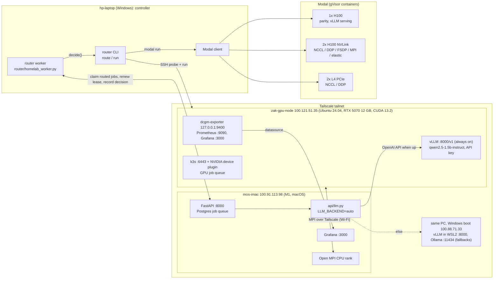

# GPU Systems Lab: results

[homelab](https://github.com/zakiscoding/homelab) (docs hub) · [homelab-services](https://github.com/zakiscoding/homelab-services) · [homelab-web](https://github.com/zakiscoding/homelab-web) · [homelab-gpu](https://github.com/zakiscoding/homelab-gpu) · **gpu-systems-lab**

[gpu-systems-lab](../README.md) / `docs/RESULTS.md` · [← repo README](../README.md) · [Code guide](CODE-GUIDE.md)

Everything measured in this repo, from one RTX 5070 up to multi-GPU H100s on Modal and two-machine
MPI over Tailscale. Every number links to the code and runbook that produced it.

## Architecture

The laptop never computes. It probes and dispatches. `router/` sends a job to the free local card
when it fits, and otherwise to the cheapest Modal GPU that meets the VRAM, deadline and cost limits.
The router worker takes routed jobs from the iMac's Postgres queue the same way. On the node, k3s
queues GPU jobs, the Grafana stack watches the card (also a datasource in the iMac Grafana), and
vLLM serves homelab chat. When the PC is booted into Windows, the iMac API uses the same vLLM setup in WSL2
(`100.88.71.33:8000`), then Ollama.
All node ports are tailnet-only.

## Headline numbers

### Single GPU: RTX 5070 vs H100 ([benchmarks/](../benchmarks/), [modal/smoke.py](../modal/smoke.py))

| 8192² matmul | RTX 5070 | H100 80GB | H100 / 5070 |
|---|---:|---:|---:|
| BF16 TFLOPS | 67.7 | 677.8 | 10.0x |
| FP16 TFLOPS | 64.1 | 714.6 | 11.1x |
| TF32 TFLOPS | 33.8 | 376.0 | 11.1x |
| FP32 TFLOPS | 23.7 | 51.8 | 2.2x |
| Host-to-device copy | 44.2 GiB/s | 25.8 GiB/s | 0.6x |

The Docker image ([docker/](../docker/)) matches the native venv within 1%. An H100 run costs about
$0.01 and starts in ~4 s.

### Hand-written CUDA kernels on the RTX 5070 ([cuda/](../cuda/), [docs/profiling/](profiling/))

| Kernel | Result | Note |
|---|---:|---|
| Matmul, tiled 16 | 2,869 GFLOPS | 8x off cuBLAS (22,834): one output per thread vs 128 per thread with register tiling |
| Warp-shuffle reduction | 641 GB/s | 95% of the 672 GB/s DRAM peak, ties CUB |
| Fused bias+GELU | 1.93x faster | memory-bound, and fusion halves DRAM traffic |
| Atomic reduction | 3.3 GB/s | 190x slower than warp shuffle |

### Custom PyTorch operator vs TorchInductor ([kernels/custom_op/](../kernels/custom_op/README.md))

`labops::rmsnorm`, a C++/CUDA op with a fake kernel and autograd registered so it runs under
`torch.compile(fullgraph=True)` (16 tests incl. `torch.library.opcheck`). In bf16 on the 5070, v1
(scalar loads) reached 290–370 GB/s. v2 (16-byte vector loads, row cached in registers, 2 vectors
per thread) reaches **541–562 GB/s, level with Inductor's generated kernel** at all 4 shapes. Eager:
57 GB/s, 9 launches per call.

### Multi-GPU: NCCL and DDP ([modal/ddp_nccl.py](../modal/ddp_nccl.py))

| | 2x L4 (PCIe) | 2x H100 (NVLink) |
|---|---:|---:|
| NCCL all-reduce busbw (1 GiB) | 6.65 GB/s | **329 GB/s** |
| DDP speedup, 134M-param MLP, batch 256/GPU | 0.34x | 1.02x |
| DDP speedup, batch 4096/GPU | — | **1.57x** (78% efficiency) |

**The interconnect decides whether a second GPU helps.** On L4s the 537 MB gradient sync
(~81 ms) swamps 18 ms of compute. On H100s it takes ~1.6 ms, which a large enough batch hides.

### MPI ([mpi/](../mpi/), [mpi/multinode/](../mpi/multinode/), [modal/mpi_multigpu.py](../modal/mpi_multigpu.py))

| Setup | Jacobi 8192²/4096² vs 1 rank | Key measurement |
|---|---:|---|
| 4 ranks sharing one RTX 5070 | 0.31x | context switching between processes |
| same, with CUDA MPS | ~0.95x (3.0x vs no MPS) | small staged message 59 → 8 µs |
| RTX 5070 + M1 iMac over Wi-Fi | ~0.05x | 2.6 ms latency, 10 MB/s; results bit-exact across GPU/CPU and x86/ARM |
| 2 ranks on 2x H100, stock Open MPI | **1.38x** | halo staged via host |
| 2x H100, CUDA-aware Open MPI | 0.95x | **324 GB/s** point-to-point, but collectives and small messages slower in the sandbox |

### Inference serving: vLLM ([serving/](../serving/), [modal/serve_vllm.py](../modal/serve_vllm.py))

Qwen2.5-1.5B with vLLM 0.32, 512 input / 256 output tokens, output tokens/s:

| Concurrent requests | RTX 5070 | H100 | H100 / 5070 |
|---:|---:|---:|---:|
| 1 | 172 | 434 | 2.5x |
| 16 | 1,987 | 5,842 | 2.9x |
| 64 | 4,430 | **16,843** | 3.8x |
| 256 | 4,791 (KV cache full, TTFT p99 7.4 s) | 11,989 | 2.5x |

- **Batching is what pays:** on the 5070, 1 → 64 concurrent requests gave 25.7x the throughput for
  2.3x the per-token latency.
- **The 7B model** doesn't fit the 12 GB card. On the H100 it peaks at 8,436 tok/s.
- **Cost:** about $0.07 per 1M tokens on an H100 at concurrency 64, vs about $2.50 serving one
  request at a time (approximate list prices).

### Inference optimization on the RTX 5070: FP16 vs AWQ vs FP8 ([serving/bench_sweep.py](../serving/bench_sweep.py), [docs/data/inference-rtx5070-2026-11-14/](data/inference-rtx5070-2026-11-14/))

Qwen2.5-1.5B-Instruct, vLLM 0.32.0, 512 random input / 256 output tokens, `gpu_memory_utilization`
0.80, prefix caching off. Each configuration ran as a GopherGrid `benchmark` job on the homelab:
the scheduler placed it on the GPU PC, and the worker started the vLLM server in a container,
swept concurrency and stopped it. Output tokens/s:

| Concurrency | FP16 | AWQ (4-bit weights) | FP8 (online, per-tensor) | AWQ / FP16 | FP8 / FP16 |
|---:|---:|---:|---:|---:|---:|
| 1 | 160 | **314** | 231 | 1.96x | 1.45x |
| 4 | 594 | **1,114** | 846 | 1.88x | 1.43x |
| 16 | 1,926 | **2,965** | 2,789 | 1.54x | 1.45x |
| 64 | 4,211 | 4,357 | **5,735** | 1.03x | 1.36x |

| Precision | Weights | KV cache | Per-token latency (TPOT p50) at 1 | End-to-end p50 / p95 at 64 | TTFT p95 at 64 |
|---|---:|---:|---:|---:|---:|
| FP16 | 2.98 GiB | 207,632 tokens | 6.08 ms | 3.85 / 4.96 s | 1.45 s |
| AWQ | 1.10 GiB | 279,312 tokens | **3.05 ms** | 3.74 / 4.83 s | 1.57 s |
| FP8 | 1.73 GiB | 255,936 tokens | 4.23 ms | **2.76 / 3.82 s** | **0.86 s** |

- **FP8 works on this Blackwell card** (compute capability 12.0). vLLM picked the CUTLASS FP8
  scaled-matmul kernel and quantized the 112 linear layers online in 0.14 s. It is the only
  option that is faster at every concurrency, and at 64 concurrent requests it gives the most
  throughput and the lowest latency.
- **AWQ wins when decoding is memory-bound.** With one request in flight, each token reads all
  the weights, and 4-bit weights halve the per-token time (3.05 vs 6.08 ms). As the batch grows,
  the work becomes compute-bound and AWQ's dequantization costs show: at 64 it is only 3%
  ahead of FP16.
- **KV cache was not the limit here.** Smaller weights left more room for KV cache, but 64
  requests × 768 tokens need about 49k tokens of the 208k–279k available, so the differences come
  from the kernels, not from capacity.
- **Caveats.** One run per configuration, and only 16 prompts at concurrency 1 and 4, so small
  differences there are noise. Output quality was not measured: AWQ is Qwen's own 4-bit checkpoint
  and FP8 is quantized on load, and both change the outputs. AWQ needed three attempts: twice the
  scheduler declared the GPU worker dead mid-run (missed heartbeats, cause not found) and
  requeued the job. GopherGrid recorded only the third attempt's result, and those are the numbers
  here.
### Speculative decoding on the RTX 5070 ([serving/prompts/](../serving/prompts/), [docs/data/spec-decoding-rtx5070-2026-11-14/](data/spec-decoding-rtx5070-2026-11-14/))

Same model and server settings (FP16), but the prompts are 256 natural-language requests
(explanations, code, rewrites, checklists; about 45 tokens each) with 256 output tokens, because
speculation can't predict a continuation of random tokens. Each configuration again ran as a
GopherGrid `benchmark` job. Output tokens/s, and the share of drafted tokens the model accepted:

| Requests in flight | Off | N-gram (4 tokens) | Draft model: Qwen2.5-0.5B (4 tokens) |
|---:|---:|---:|---:|
| 1 | **165** | 145 (2% accepted) | 56 (30% accepted) |
| 4 | **629** | 520 (2%) | 174 (27%) |
| 16 | **2,392** | 1,653 (2%) | 731 (27%) |
| 64 | **7,746** | 2,770 (2%) | 2,564 (27%) |

- **Speculation made this model slower at every concurrency.** A 1.5B model on this card
  already decodes a token in 6.0 ms with one request, so there is little idle time for a draft to
  fill. Per-token latency at one request went to 7.0 ms with n-grams and 18.1 ms with the draft.
- **N-gram lookup found almost nothing to copy.** Only 2% of its proposals were accepted: answers
  to these prompts rarely repeat the prompt's own text. It suits workloads that do, such as
  editing code or quoting a document, which this set has only a little of.
- **The 0.5B draft is too big for a 1.5B target.** It is a third of the target's size, so four
  draft steps cost more than they save at a 27–30% acceptance rate. It also took 0.9 GiB of
  weights and half the KV cache (119k tokens vs 208k).
- **Caveats.** `--ignore-eos` forces 256 output tokens even where the model would stop, and the
  prompts go to `/v1/completions` without the chat template; both likely lower acceptance. The
  speculation depth (4) wasn't tuned. Speculative decoding is meant for larger targets, such as a
  7B model with a 0.5B draft, which doesn't fit this card in FP16. Throughput here is higher than in
  the table above because these prompts are short, so don't compare the two tables directly.

### Sharded training and fault tolerance ([distributed/](../distributed/), [modal/fsdp_train.py](../modal/fsdp_train.py), [modal/elastic_train.py](../modal/elastic_train.py))

| 2x H100, per GPU | DDP | FSDP2 |
|---|---:|---:|
| 1.34B params: peak memory | 31.0 GiB | **15.6 GiB** (12.8 with activation checkpointing) |
| 1.34B params: step time | 125.8 ms | 113.6 ms |
| 5.64B params | **OOM** at 77 of 79 GiB | trains, 52.7 GiB, 293 ms/step |

- **Checkpoint/resume** with `torch.distributed.checkpoint` is bit-exact in deterministic mode
  (2.45 GiB checkpoint: 2.0 s save, 1.5 s load).
- **Elastic restart:** `torchrun --max-restarts`, one rank killed at step 48 of 60. Training resumed
  from the last checkpoint and ended with a bit-identical final loss. Time lost was 11.0 s
  (checkpoint every 10 steps) or 14.4 s (every 25).

### Operations: observability and scheduling ([observability/](../observability/), [scheduling/](../scheduling/))

- **Observability:** dcgm-exporter works on the GeForce card, including the SM-active,
  tensor-pipe and DRAM profiling fields. Under a benchmark: GPU 0 → 100%, power 2 → 229 W,
  temperature 36 → 63 °C, SM clock 180 → 2,820 MHz. The benchmark result was unchanged
  (67.7 TFLOPS).
- **k3s scheduling:** GPU pods run at native speed (67.7 TFLOPS). Three 1-GPU jobs submitted at
  once queue and run one at a time.

| Same work, 3 jobs | per job | combined | mean finish |
|---|---:|---:|---:|
| Exclusive (queue) | 67.5 TFLOPS | 67.5 | **101 s** |
| Time-sliced x4 | 21.4 TFLOPS | 64.2 | 149 s |

  Time-slicing a saturated GPU adds ~5% overhead and makes jobs finish later. It only helps jobs
  that leave the GPU idle. A ValidatingAdmissionPolicy now blocks pods that would use the GPU
  without requesting it (a queue bypass found during testing).

## What the numbers say

1. **Develop locally, scale on rented H100s.** The 5070 is free and fast enough for kernels and
   small models. One H100 is 10x faster at about $4/hour.
2. **Multi-GPU only pays with a fast interconnect and enough work per step.** NVLink plus large
   batches gave 1.57x. PCIe L4s and Wi-Fi made things slower.
3. **Keep data on the GPU.** NCCL (329 GB/s) beat every MPI path. CUDA-aware MPI matched NVLink
   for big point-to-point messages, but its collectives still went through the host.
4. **Sandboxes have costs.** Modal's gVisor blocks TUN devices (no Tailscale interface) and host
   memory pinning (`cuMemHostRegister` fails), and roughly halves host shared-memory bandwidth.
5. **Correctness first.** Every benchmark checks its result: matmul against cuBLAS and the CPU,
   Jacobi bit-exact against a serial run, all-reduce sums verified on every rank, resumed training
   bit-exact against an uninterrupted run.
6. **Memory decides the training strategy.** DDP keeps a full copy of params, grads and Adam state
   (16 bytes/param) on every GPU. FSDP shards it, which turned a 5.6B-parameter OOM into a working
   run on the same two GPUs.
7. **Serving is a batching problem.** Throughput comes from concurrency until the KV cache fills.
   After that, latency explodes and throughput stops growing.
8. **Quantization is a latency tool first.** On a small model, 4-bit AWQ halved per-token time
   for a single user but barely helped a full batch. FP8 helped everywhere on Blackwell.
   Speculative decoding, the other textbook latency trick, made a small model slower: the
   target was already fast, and neither n-grams nor a 0.5B draft predicted enough of it.
9. **Measure what the platform hides.** The GPU limit in Kubernetes turned out to be accounting,
   not enforcement, until an admission policy made it real.

## Runbooks

| Task | Where |
|---|---|
| Node baseline, venv, smoke test | [scripts/](../scripts/), [README](../README.md) |
| CUDA kernels, PTX, LLVM IR | [cuda/README.md](../cuda/README.md) |
| Profiling (Nsight Systems; Nsight Compute needs a driver flag) | [docs/profiling/README.md](profiling/README.md) |
| Docker benchmark image | [docker/README.md](../docker/README.md) |
| Modal parity, NCCL, DDP | [modal/README.md](../modal/README.md) |
| MPI on one node and on 2 GPUs | [mpi/README.md](../mpi/README.md) |
| MPI across two machines | [mpi/multinode/README.md](../mpi/multinode/README.md) |
| Job router | [router/README.md](../router/README.md) |
| vLLM serving (node + H100) | [serving/README.md](../serving/README.md) |
| FSDP, checkpoints, elastic restart | [distributed/README.md](../distributed/README.md) |
| GPU monitoring stack | [observability/README.md](../observability/README.md) |
| k3s GPU scheduling | [scheduling/README.md](../scheduling/README.md) |
| Node hardening (firewall, profiling, sudo) | [scripts/harden_node.sh](../scripts/harden_node.sh) |

Total Modal spend for all of the above: about $3.20.
