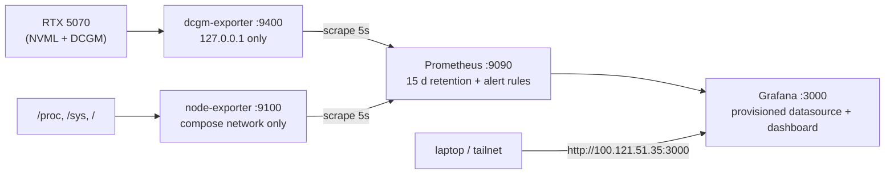

# GPU observability

[homelab](https://github.com/zakiscoding/homelab) (docs hub) · [homelab-services](https://github.com/zakiscoding/homelab-services) · [homelab-web](https://github.com/zakiscoding/homelab-web) · [homelab-gpu](https://github.com/zakiscoding/homelab-gpu) · **gpu-systems-lab**

[gpu-systems-lab](../README.md) / `observability/` · [← repo README](../README.md) · [Results](../docs/RESULTS.md) · [Code guide](../docs/CODE-GUIDE.md)

Prometheus + Grafana monitoring for `zak-gpu-node` (RTX 5070, 12 GB, driver 595.99.02). GPU metrics
come from NVIDIA's **dcgm-exporter**, and host CPU, RAM and disk come from node-exporter. Anything
else running on the card shows up here too, such as the vLLM benchmarks and the k3s/Slurm jobs.



| File | Purpose |
|---|---|
| `docker-compose.yml` | the four services, all image versions pinned |
| `dcgm/counters.csv` | the DCGM fields to export (default set plus the profiling and PCIe fields) |
| `prometheus/prometheus.yml` | scrape config (dcgm, node, prometheus) |
| `prometheus/alerts.yml` | alert rules: GPU temp > 85 °C, memory > 95%, XID error, exporter down |
| `grafana/provisioning/` | Prometheus datasource (uid `prometheus`) and the dashboard provider |
| `grafana/dashboards/gpu-node.json` | the "GPU node: RTX 5070" dashboard |
| `verify.sh` | end-to-end check; `--load` also runs a GPU load and reports peak values |
| `.env.example` | template for `.env` (bind IP, Grafana admin password). `.env` is gitignored |

Pinned images: `nvcr.io/nvidia/k8s/dcgm-exporter:4.6.1-4.8.4-distroless` (DCGM 4.6.1),
`prom/prometheus:v3.5.0`, `prom/node-exporter:v1.9.1`, `grafana/grafana:12.1.1`.

## Start / stop

On the GPU node (Docker plus the NVIDIA Container Toolkit):

```bash
cd ~/gpu-systems-lab/observability
cp .env.example .env
sed -i "s/^GF_SECURITY_ADMIN_PASSWORD=.*/GF_SECURITY_ADMIN_PASSWORD=$(openssl rand -hex 16)/" .env
chmod 600 .env
docker compose up -d          # start (restart: unless-stopped, so it also comes back after a reboot)
./verify.sh                   # health + current values
./verify.sh --load            # + runs benchmarks/smoke_test.py and prints peaks and a timeline
docker compose down           # stop (keeps the data volumes)
docker compose down -v        # stop and delete Prometheus/Grafana data
```

## URLs (tailnet only)

| Service | URL | Access |
|---|---|---|
| Grafana | http://100.121.51.35:3000 (dashboard: `/d/gpu-node`) | anonymous **Viewer**. Log in as `admin` with the password from `.env` on the node to edit |
| Prometheus | http://100.121.51.35:9090 | read-only UI and API, no auth |
| dcgm-exporter | http://127.0.0.1:9400/metrics | from the node itself only |
| node-exporter | none | reachable only on the compose network |

Published ports bind to `BIND_IP` from `.env` (the Tailscale IP), never to `0.0.0.0`. The node sits
on a home LAN, and its firewall ([`scripts/harden_node.sh`](../scripts/harden_node.sh)) only blocks
22/6443/10250 there, so this matters. I checked that `10.0.0.21:{3000,9090,9400,9100}`
refuses connections and that both tailnet URLs return 200 from the laptop. One trade-off: if
`tailscale0` is not up when Docker starts, the Grafana and Prometheus containers can't bind and
won't start. Run `docker compose up -d` again once Tailscale is up, or set `BIND_IP=127.0.0.1` and
use an SSH tunnel instead.

For Grafana access from outside the tailnet, see [Grafana Access](../cloudflare/README.md#grafana-access). It requires an
Access login because Grafana allows anonymous viewers. Prometheus stays private. The stack also runs in WSL2 on the
Windows boot, using [compose.wsl.yml](compose.wsl.yml).

## What the dashboard shows

- **GPU now (stat tiles):** GPU utilization, memory used %, power draw, temperature, SM clock, and PCIe link generation and width.
- **GPU over time:**
  - utilization, plus memory-controller utilization
  - DCGM profiling: SM active, SM occupancy, tensor pipe active, DRAM active, graphics engine active
  - memory used and total, and power draw against the power limit
  - temperature and fan speed, and SM, memory and max clocks
  - PCIe TX/RX throughput, plus the clock event (throttle) reason bitmask and P-state
- **Host:** CPU busy and iowait, RAM used and total, load1, root filesystem used %.
- A `$gpu` variable is ready for more GPUs. There's no NVLink panel because the RTX 5070 has no NVLink.

`DCGM_FI_DEV_GPU_UTIL` is the driver's figure: the share of time at least one kernel was running.
It reads 100% even when a kernel keeps only a few SMs busy. `DCGM_FI_PROF_SM_ACTIVE` and
`PIPE_TENSOR_ACTIVE` show how much of the chip is actually working, so the dashboard plots them
next to each other.

## Exporter choice and limits on GeForce

I tried dcgm-exporter first and it works on this consumer card, so there's no nvidia-smi fallback.
DCGM 4.6.1 recognises the RTX 5070 and driver 595.99.02. The profiling module loads with `cap_add: SYS_ADMIN`
and gives real `DCGM_FI_PROF_*` values (SM active, occupancy, tensor, DRAM, PCIe bytes). I had
expected these to be datacenter-only. Limits I saw on this card:

| Field | On RTX 5070 |
|---|---|
| `DCGM_FI_DEV_MEMORY_TEMP` | always 0. GeForce doesn't expose a GDDR7 temperature sensor |
| `DCGM_FI_DEV_XID_ERRORS` | no series emitted (no XID since the exporter started). The alert rule fires once one shows up |
| `DCGM_FI_PROF_PCIE_{TX,RX}_BYTES` | a **rate in bytes/s** (headers included), not a counter, so it's plotted raw without `rate()`. DCGM samples it, so a sub-second 35 GiB/s copy shows up as ~1.5 GB/s averaged over the window |
| NvLink / NvSwitch / CPU entities | none ("no switches to monitor", CPU module not loaded). Expected on a single consumer card |
| ECC, row remapping, NVLink bandwidth, MIG | not on GeForce, so they aren't in `counters.csv` |
| `DCGM_FI_DEV_PCIE_LINK_GEN` | drops to Gen 1 at idle and reaches Gen 5 under load (power saving). x16 width throughout |

Other notes:

- The exporter collects every 5 s (`-c 5000`); the default is 30 s. Prometheus scrapes every 5 s.
- node-exporter runs on the bridge network, so its network-interface counters belong to the container. The dashboard leaves network panels out for that reason.
- The first Grafana start hit `database is locked` during SQLite migrations while other jobs were loading the disk. Grafana restarted once on its own. Turning on `GF_DATABASE_WAL` plus query and transaction retries fixed it.

## Evidence (2026-10-23)

All values come from the Prometheus query API, running `./verify.sh` and `./verify.sh --load` on the
node. A vLLM engine from another job was resident on the GPU the whole time (about 3.8 to 7.5 GiB),
so "idle" memory isn't zero.

Health: four containers up. Prometheus targets `dcgm`, `node` and `prometheus` are all `up`. The
exporter serves 29 `DCGM_FI_*` series and all 4 alert rules evaluate `ok` (inactive). Grafana
`/api/health` returns `database: ok, version 12.1.1`, and anonymous `/api/search` lists the
provisioned "GPU node: RTX 5070" dashboard (uid `gpu-node`). The datasource health check reports
"Successfully queried the Prometheus API", and a query through Grafana's `/api/ds/query` returned data.

Idle compared with the peak during `benchmarks/smoke_test.py` (8192² matmuls in FP32/TF32/FP16/BF16 plus an H2D copy):

| PromQL | Idle (second run) | Peak during load (run 1 / run 2) |
|---|---:|---:|
| `DCGM_FI_DEV_GPU_UTIL` | 0 % | 100 % / 100 % |
| `DCGM_FI_PROF_SM_ACTIVE` | 0 | 0.94 / 0.98 |
| `DCGM_FI_PROF_PIPE_TENSOR_ACTIVE` | 0 | 0.46 / 0.25 |
| `DCGM_FI_DEV_FB_USED` (MiB, of 12227) | 7450 | 8704 / 8451 |
| `DCGM_FI_DEV_POWER_USAGE` (W, limit 250) | 2.1 | 227.1 / 228.7 |
| `DCGM_FI_DEV_GPU_TEMP` (°C) | 36 | 61 / 63 |
| `DCGM_FI_DEV_SM_CLOCK` (MHz, max 3090) | 180 | 2820 / 2662 |
| `DCGM_FI_PROF_PCIE_RX_BYTES` (B/s) | 73,554 | 1,549,657,124 (run 2) |
| `DCGM_FI_DEV_CLOCKS_EVENT_REASONS` | 0 | 4 (SW power cap) |

Run 1's PCIe peak isn't shown because it was queried with `rate()`, which is wrong for this
rate-type field (see the limits above).

The run 2 timeline (`query_range`, 5 s step) shows the metrics move with the benchmark:

```
t      gpu_util%  sm_active  power_W  temp_C  pcie_rx_MB/s
+  0s      0       0.00       3.3     36        0.1
+ 10s      0       0.00       2.1     36        0.1
+ 15s      0       0.37      45.2     56        2.6
+ 20s    100       0.98     228.7     63        0.6
+ 25s      0       0.33      22.2     39     1549.7
+ 30s      0       0.00       6.1     38        0.1
```

The smoke test's own output for the same run: BF16 67.69 TFLOPS, FP16 65.1, TF32 33.79, FP32 23.42,
H2D pinned 34.95 GiB/s. These are the same as the numbers in [docs/RESULTS.md](../docs/RESULTS.md),
so the exporter did not slow the GPU down.
