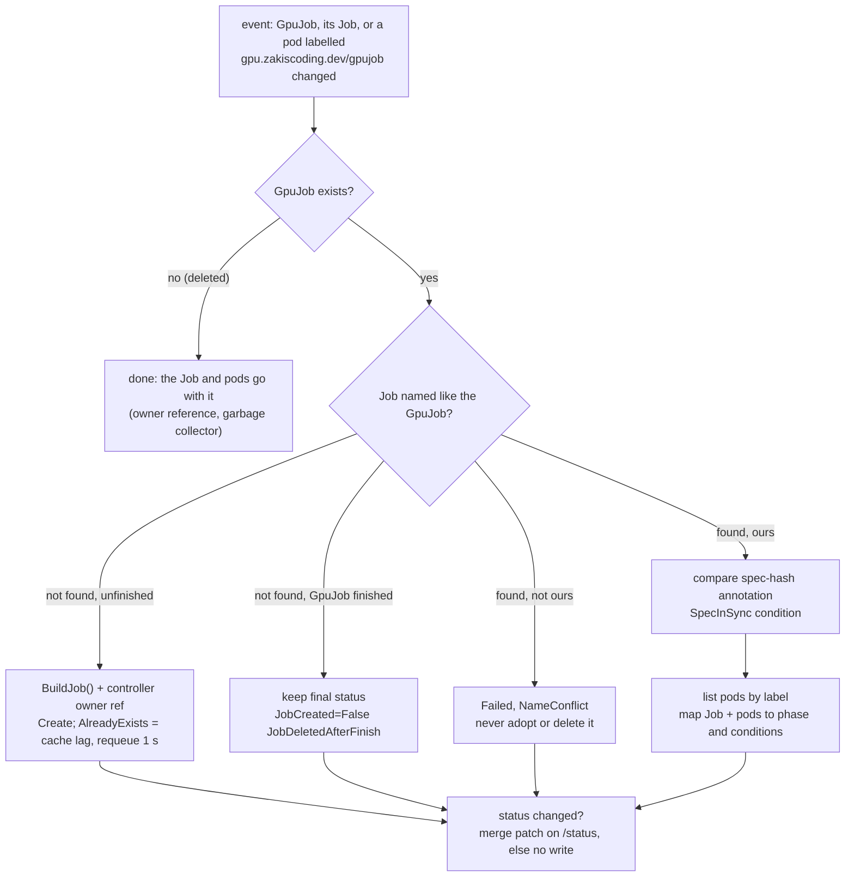

# GpuJob operator

[gpu-systems-lab](../README.md) / `operator/` · [Scheduling](../scheduling/README.md) · [GPU Operator plan](../scheduling/gpu-operator/README.md) · [Code guide](../docs/CODE-GUIDE.md)

A small Kubernetes operator, written in Go with controller-runtime, that adds one resource:
**`GpuJob`** (`gpu.zakiscoding.dev/v1alpha1`). You describe a container and how many GPUs it
needs; the controller turns it into a `batch/v1` Job with `runtimeClassName: nvidia` and an
`nvidia.com/gpu` limit, and reports the Job's progress back as `Pending`, `Running`,
`Succeeded` or `Failed`, including *why* a job is still pending ("queued: Insufficient
nvidia.com/gpu").

It is the cluster-side version of [`scheduling/submit.py`](../scheduling/submit.py): the same
Job shape, but declarative, so `kubectl apply` is the whole submit step and the status lives
in the API server instead of a terminal.

```yaml
apiVersion: gpu.zakiscoding.dev/v1alpha1
kind: GpuJob
metadata: {name: matmul-bf16, namespace: gpu-jobs}
spec:
  image: pytorch/pytorch:2.7.1-cuda12.8-cudnn9-runtime
  command: ["python", "/bench/bench.py"]
  gpus: 1                      # default 1, 1..8
  memory: 4Gi                  # container RAM (request = limit), not VRAM
  activeDeadlineSeconds: 900
  ttlSecondsAfterFinished: 3600
```

```
$ kubectl -n gpu-jobs get gpujobs
NAME     PHASE       GPUS   JOB      STARTED   AGE
demo-a   Running     1      demo-a   9s        9s
demo-b   Pending     1      demo-b   9s        9s
```

**Status: tested with envtest (16 test functions, 31 cases with subtests, all passing) and run end to end on a local kind
cluster with a *fake* `nvidia.com/gpu` resource. It has not yet run on the real k3s GPU node,
which is booted into Windows right now.** See [Results](#results) and [Limitations](#limitations).

## Spec and status

| Field | Default | Becomes |
|---|---|---|
| `image` (required) | | container image |
| `command`, `args`, `env` | | the same container fields |
| `gpus` | 1 (min 1, max 8) | `limits: nvidia.com/gpu` (extended resources: request = limit) |
| `cpu` | none | `requests.cpu` (no CPU limit, to avoid throttling data loaders) |
| `memory` | none | `requests.memory` and `limits.memory` |
| `backoffLimit` | 0 (max 10) | `Job.spec.backoffLimit`. A failed GPU job usually fails the same way again |
| `activeDeadlineSeconds` | none (min 1) | `Job.spec.activeDeadlineSeconds`. Counts from Job start, so queue time counts |
| `ttlSecondsAfterFinished` | none | `Job.spec.ttlSecondsAfterFinished`. Deletes the Job; the GpuJob and its status stay |

The controller always sets `restartPolicy: Never`, `runtimeClassName: nvidia` (flag
`--runtime-class`) and the label `gpu.zakiscoding.dev/gpujob=<name>` on the Job and its pods.

`status`: `phase`, `jobName`, `startTime` (the Job's start, which includes time queued),
`completionTime` (success or failure), `message`, `observedGeneration`, and conditions:

| Condition | Meaning |
|---|---|
| `JobCreated` | True once the Job exists. Reasons `Created`, `Recreated`; False with `NameConflict` or `JobDeletedAfterFinish` |
| `Scheduled` | False with `Unschedulable` and the scheduler's message while the pod waits for a GPU; True (`Bound`) once on a node |
| `Finished` | True with reason `Succeeded` or `Failed` |
| `SpecInSync` | False (`SpecDrift`) if the Job was built from a different spec than the GpuJob has now |

Printer columns: `Phase`, `GPUs`, `Job`, `Started`, `Age`, and `Message` with `-o wide`. Short name `gj`.

## Design



Decisions, and why:

- **Idempotent by construction.** The Job has the same name as the GpuJob, so "does my Job
  exist" is a `Get`, not a label search, and a second `Create` can only fail with
  `AlreadyExists`, never make a duplicate. Status is written only when it changed, so a
  reconcile with nothing to do makes no API writes at all (the idempotency test checks the
  resourceVersions of both objects).
- **The spec is immutable** (a CEL rule, `self == oldSelf`, on `spec`). Nearly every field ends
  up in the Job's pod template, which Kubernetes does not let you change after creation either.
  "Edit a running GPU job" could only mean "kill the pod and lose the work", and that should be an
  explicit `kubectl delete` + `apply`, not a side effect of an edit. Metadata (labels,
  annotations) can still change.
- **Drift is reported, not repaired.** The Job carries the hash of the spec it was built from
  (`gpu.zakiscoding.dev/spec-hash`). If it ever differs from the GpuJob (an operator upgrade that
  changes the Job template, or the CEL rule bypassed), `SpecInSync` goes False with both
  hashes. The running Job is left alone, for the same reason.
- **Missing Job.** If the Job disappears while the GpuJob is unfinished (someone deleted it), the
  controller creates it again (`JobCreated` reason `Recreated`). If the GpuJob already finished,
  a missing Job is expected (`ttlSecondsAfterFinished`) and is **not** recreated, because rerunning a
  finished job is never what you want. The final status is kept.
- **Someone else's Job with our name** is never adopted or deleted. The GpuJob goes `Failed`
  with `NameConflict`.
- **Deletes cascade through the owner reference** (`controller: true`,
  `blockOwnerDeletion: true`), so the operator needs no finalizer. Deleting a GpuJob deletes its
  Job, and the Job's pods.
- **Status from pods, not just the Job.** The Job alone cannot tell "queued for a GPU" from
  "pulling an image". The controller also watches pods with its label (the informer cache is
  restricted to those pods, so it does not cache every pod in the cluster) and copies the
  scheduler's `PodScheduled=False` message into `Scheduled` and `message`.
- **Status writes** go to the status subresource as a merge patch. Only this controller writes
  status, so no resourceVersion precondition is needed, and users editing labels never
  conflict with it. (An earlier version used `Update` and logged harmless conflict retries in
  the tests.)
- **It passes the repo's admission policy** (`scheduling/manifests/50-require-gpu-limit-policy.yaml`)
  by construction: one container, nvidia runtime class, GPU limit set. The kind run applies that
  policy and shows a pod without a limit being denied.

RBAC (generated from `+kubebuilder:rbac` markers into `config/rbac/role.yaml`): read GpuJobs,
write `gpujobs/status`, `get/list/watch/create` Jobs (no update or delete: the operator never
changes a Job it made), read pods, write events, and leases for leader election. The
container runs as non-root on distroless, read-only root filesystem, all capabilities dropped.

## Layout

| Path | What |
|---|---|
| `api/v1alpha1/gpujob_types.go` | The CRD types and their validation, default and printer-column markers |
| `api/v1alpha1/zz_generated.deepcopy.go` | Generated (`controller-gen object`) |
| `internal/controller/jobbuilder.go` | `BuildJob`: GpuJob to Job, a pure function. `SpecHash` |
| `internal/controller/gpujob_controller.go` | The reconciler, status mapping, watches, RBAC markers |
| `internal/controller/jobbuilder_test.go` | Unit tests: the builder and the Job-to-phase mapping, no API server |
| `internal/controller/suite_test.go`, `gpujob_controller_test.go` | envtest tests: real kube-apiserver + etcd 1.36.2, controller running in a manager |
| `cmd/main.go` | The manager: flags, health probes, metrics on `:8080`, leader election |
| `config/crd/bases/` | Generated CRD (`controller-gen crd`) |
| `config/rbac/`, `config/manager/`, `config/default/` | Kustomize: `kubectl apply -k config/default` installs it all in `gpujob-system` |
| `config/samples/gpujob_matmul.yaml` | A bf16 matmul GpuJob for the real node |
| `Dockerfile` | `golang:1.26` build, `distroless/static:nonroot` runtime, 50.5 MB image |
| `Makefile` | `generate`, `fmt`, `vet`, `unit`, `test`, `build` |
| `hack/in-docker.sh` | Runs any of those in `golang:1.26` (the laptop has no Go) |
| `hack/kind/` | The kind demo: tools image (kind, kubectl, docker CLI), stub RuntimeClass, demo GpuJobs, `run-demo.sh`, `transcript.txt` |

Versions: Go 1.26.11, controller-runtime v0.25.2, k8s.io/* v0.37.2, controller-tools v0.23.0,
envtest binaries 1.36.2 (chosen to match the node's k3s v1.36.5).

## Run it

Everything runs in containers; Docker is the only requirement.

```bash
cd operator
./hack/in-docker.sh make generate       # deepcopy, CRD YAML, RBAC from markers
./hack/in-docker.sh make unit           # builder + status mapping only, no API server
./hack/in-docker.sh make test           # unit + envtest (downloads kube-apiserver/etcd once)
bash hack/kind/run-demo.sh              # kind cluster gpujob-op, fake GPU, demo, cluster deleted
```

On the k3s node (once booted into Ubuntu; `nvidia` RuntimeClass and the device plugin already exist):

```bash
docker build -t gpujob-operator:dev operator/
docker save gpujob-operator:dev | sudo k3s ctr images import -     # k3s uses its own containerd
kubectl apply -k operator/config/default
kubectl apply -f scheduling/manifests/40-bench-configmap.yaml
kubectl apply -f operator/config/samples/gpujob_matmul.yaml
kubectl -n gpu-jobs get gj -w
```

## Results

Measured 2026-11-14 (UTC) on the Windows 11 laptop, Docker Desktop 29.8, everything in containers.

### Tests: 31 of 31 pass

`./hack/in-docker.sh make test`, full output in [`hack/test-output.txt`](hack/test-output.txt):

```
--- PASS: TestCreatesJobWithGPULimitRuntimeClassAndOwner (2.11s)   # first test also waits for the manager's caches
--- PASS: TestReconcileIsIdempotent (0.71s)
--- PASS: TestStatusSucceeded (0.11s)
--- PASS: TestStatusFailed (0.19s)
--- PASS: TestPendingQueuedThenRunning (0.25s)
--- PASS: TestJobDeletedWhileUnfinishedIsRecreated (0.24s)
--- PASS: TestJobDeletedAfterFinishIsNotRecreated (1.19s)
--- PASS: TestNameConflictWithForeignJob (0.08s)
--- PASS: TestSpecDriftIsReported (0.12s)
--- PASS: TestCRDValidation (0.10s)              # 8 subtests
--- PASS: TestBuildJobGPUAndRuntime (0.00s)
--- PASS: TestBuildJobJobFields (0.00s)
--- PASS: TestBuildJobDefaults (0.00s)
--- PASS: TestBuildJobRuntimeClassFlag (0.00s)
--- PASS: TestSpecHash (0.00s)
--- PASS: TestApplyJobStatus (0.00s)             # 7 subtests
ok  	github.com/zakiscoding/gpu-systems-lab/operator/internal/controller	13.068s
```

10 envtest tests (kube-apiserver + etcd 1.36.2, the controller running in a real manager) and 6
plain unit tests; 31 cases counting subtests. 13.1 s for the package, most of it starting the
API server. The suite also passed 3 runs in a row with `-count=3` (20.4 s). What each envtest
test proves:

| Test | Checks |
|---|---|
| CreatesJob... | Job has `runtimeClassName: nvidia`, `nvidia.com/gpu: 1` (CRD default), a controller owner ref with `blockOwnerDeletion`; GpuJob goes Pending with `JobCreated=True` and `observedGeneration` |
| ReconcileIsIdempotent | 3 extra reconciles with an *uncached* client: still 1 Job, and neither the Job's nor the GpuJob's resourceVersion moved (no writes) |
| StatusSucceeded / StatusFailed | Job status written the way the job controller does (`SuccessCriteriaMet`+`Complete`, `FailureTarget`+`Failed`) maps to Succeeded/Failed with times and `Finished` |
| PendingQueuedThenRunning | An unschedulable pod ("Insufficient nvidia.com/gpu") gives `Scheduled=False` and `queued: ...`; bound + running gives Running |
| JobDeletedWhileUnfinished... | Job deleted mid-run is recreated (new UID), reason `Recreated` |
| JobDeletedAfterFinish... | Job deleted after success (what the TTL does) is *not* recreated; Succeeded is kept |
| NameConflictWithForeignJob | A pre-existing Job with the same name is not adopted; GpuJob Failed, `NameConflict` |
| SpecDriftIsReported | Tampered spec-hash gives `SpecInSync=False`; the Job is not replaced |
| CRDValidation | `gpus` 0 and 9, missing/empty image, negative backoff, zero deadline rejected; defaults applied; spec update rejected as immutable |

envtest has no scheduler, kubelet, job controller or garbage collector, so the tests write
Job and Pod status themselves, and cascade deletion is checked on kind instead.

### kind run with a fake GPU

`bash hack/kind/run-demo.sh`: kind v0.33.0, node image `kindest/node:v1.37.0` (kind's default;
the real node is k3s 1.36.5), kubectl 1.36.5. **The node has no GPU.** `nvidia.com/gpu: 1` was
added by patching the node's status, and RuntimeClass `nvidia` points at plain `runc`. The repo's
namespace and admission policy were applied unchanged. Full output:
[`hack/kind/transcript.txt`](hack/kind/transcript.txt); excerpts (long lines wrapped or cut with `...`):

```
$ kubectl get node gpujob-op-control-plane -o jsonpath='capacity=... allocatable=...'
capacity=1 allocatable=1

$ kubectl apply --dry-run=server -f hack/kind/no-limit-pod.yaml        # nvidia runtime, no GPU limit
... ValidatingAdmissionPolicy 'require-gpu-limit-with-nvidia-runtime' ... denied request ...

$ kubectl apply -f hack/kind/demo-jobs.yaml        # demo-a and demo-b, 1 GPU and 20 s each
[01:35:24] watch | ADDED      demo-a ...
[01:35:24] watch | ADDED      demo-b ...
[01:35:29] watch | MODIFIED   demo-a   Running   1      demo-a   5s        5s

$ kubectl -n gpu-jobs get gpujobs -o wide
NAME     PHASE     GPUS   JOB      STARTED   MESSAGE                                                         AGE
demo-a   Running   1      demo-a   8s        pod running                                                     8s
demo-b   Pending   1      demo-b   8s        queued: 0/1 nodes are available: 1 Insufficient nvidia.com/gpu. 8s
                                             preemption: 0/1 nodes are available: 1 No preemption victims ...

[01:35:52] watch | MODIFIED   demo-a   Succeeded   1      demo-a   28s       28s
[01:35:54] watch | MODIFIED   demo-b   Running     1      demo-b   29s       29s
[01:36:16] watch | MODIFIED   demo-b   Succeeded   1      demo-b   52s       52s

$ kubectl -n gpu-jobs get gpujob demo-fail -o wide        # sh -c 'exit 3', backoffLimit 0
demo-fail   Failed   1      demo-fail   3s        BackoffLimitExceeded: Job has reached the specified backoff limit

$ kubectl -n gpujob-system rollout restart deploy/gpujob-operator    # then:
$ kubectl -n gpu-jobs get jobs -L gpu.zakiscoding.dev/gpujob
NAME        STATUS     COMPLETIONS   DURATION   AGE   GPUJOB
demo-a      Complete   1/1           28s        78s   demo-a
demo-b      Complete   1/1           52s        78s   demo-b
demo-fail   Failed     0/1           25s        25s   demo-fail
created-Job lines after restart: 0

$ kubectl -n gpu-jobs delete gpujob demo-a --wait=true
$ kubectl -n gpu-jobs get jobs,pods -l gpu.zakiscoding.dev/gpujob=demo-a
No resources found in gpu-jobs namespace.

$ kubectl -n gpu-jobs patch gpujob demo-b --type=merge -p '{"spec":{"gpus":2}}'
The GpuJob "demo-b" is invalid: spec: Invalid value: spec is immutable; delete and re-create the GpuJob
```

What the run shows:

| | |
|---|---|
| Queueing | demo-b waited **28 s** (01:35:24 to 01:35:52) with `Scheduled=False`, then was scheduled in the same second demo-a finished and started 1 s later. Total 52 s for two 20 s jobs plus a 2 s image pull |
| Phases | Pending, Running, Succeeded for both; Pending, Running, Failed for `demo-fail` (3 s) |
| Restart | The new operator pod took the lease, re-reconciled all 3 GpuJobs and created 0 Jobs |
| Cascade | Deleting `demo-a` removed its Job and pod within 5 s |
| Admission | The policy denied a GPU-runtime pod without a limit; every operator-made pod passed it |

Two bugs the first kind run found that envtest did not (both fixed; the first now has unit tests):
the phase flickered Running, Pending, Succeeded in the second between the pod exiting and the
Job controller marking the Job complete; and after a rolling restart the new pod waited for
the old leader lease to expire (now `LeaderElectionReleaseOnCancel`). The first full run
also showed `allocatable` empty for about 2 s after the status patch; the script now waits for it.

Timings from this laptop: `kind create cluster` 43 s (2.5 min the first time, pulling the node
image); operator image build about 10 min from cold (BuildKit compiling client-go), 50.5 MB.

## Limitations

- **Not yet on the real GPU.** The kind run used a fake `nvidia.com/gpu: 1` (a node status
  patch) and a stub `nvidia` RuntimeClass with the `runc` handler. The pods got no GPU; the
  demo container is busybox. What it proves is the control loop, the scheduling/queueing
  behaviour and the admission policy, not GPU access. The k3s run is pending the Ubuntu boot.
- **One container per job, one pod per Job.** No `parallelism`, no indexed or multi-node jobs,
  no volumes or ConfigMap mounts yet (so the repo's `bench.py` ConfigMap cannot be mounted;
  the sample inlines the matmul instead). `submit.py` still covers those cases.
- **No queue of its own.** Ordering is whatever the kube-scheduler does with unschedulable pods
  (retries with backoff, not strict FIFO). There are no priorities, quotas or fair sharing;
  Kueue is the tool for that.
- **`gpus` > 1 on this hardware** never schedules with the exclusive plugin (one card) and is
  rejected by the time-sliced plugin (`failRequestsGreaterThanOne`). The CRD allows up to 8 for
  other nodes.
- **No MIG and no NVLink on a GeForce RTX 5070.** Time-slicing (see
  [the GPU Operator plan](../scheduling/gpu-operator/README.md)) is the only way to share the
  card, and it has no memory or fault isolation; `spec.memory` limits RAM, not VRAM.
- **The GPU limit is still accounting, not enforcement**, as measured in
  [scheduling/](../scheduling/README.md#hardening-items). The admission policy is what stops pods
  from using the runtime class without a limit; the operator just always sets one.
- **Garbage collection is not covered by envtest** (it has no kube-controller-manager). The
  owner reference is unit-checked there; the actual cascade was observed on kind.
