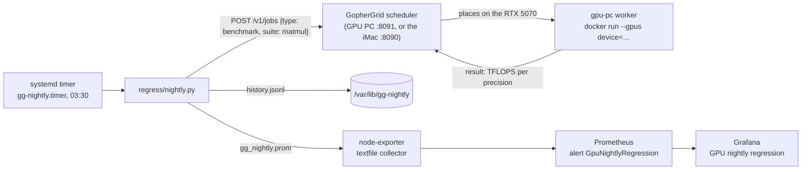

# Nightly GPU performance regression tracking (through GopherGrid)

[gpu-systems-lab](../README.md) / `regress/` · [Observability](../observability/) · [GopherGrid](https://github.com/zakiscoding/gophergrid)

Each night the GPU PC runs the same GPU benchmark **as a GopherGrid job**, stores the result, and
flags any precision whose TFLOPS dropped more than 5% below its recent baseline. The flag shows on a
Grafana dashboard and fires a Prometheus alert.



| File | What it is |
|---|---|
| [nightly.py](nightly.py) | Submit, wait, record, compare, write gauges. The baseline is the **median of the previous 7 successful runs**; at least 3 are needed before anything is judged. Test runs (`--label`) are recorded but never become baseline |
| [test_nightly.py](test_nightly.py) | Baseline and threshold logic, the exact 5% boundary, which runs count as baseline, the Prometheus output (6 tests) |
| [gg-nightly.service](gg-nightly.service), [gg-nightly.timer](gg-nightly.timer) | systemd units on the GPU PC (WSL Ubuntu, systemd on). `Persistent=true` catches up on a missed night |
| [../observability/grafana/dashboards/gpu-nightly-regression.json](../observability/grafana/dashboards/gpu-nightly-regression.json) | Regression flag per precision, hours since the last run, TFLOPS vs baseline, ratio to baseline with the 0.95 line |
| [../observability/prometheus/alerts.yml](../observability/prometheus/alerts.yml) | `GpuNightlyRegression` (flag = 1) and `GpuNightlyJobMissing` (failed, or nothing for 2 days) |

**Why not GitHub Actions on this PC?** A self-hosted runner attached to a public repository would run
code from anyone's pull request on the GPU PC. The timer runs a fixed script from a local checkout;
GitHub never schedules anything here.

**Why it's safe next to chat:** the job asks GopherGrid for 1 GPU and 900 MB. The `gpu-pc` worker
keeps the rest reserved for `vllm-chat` (`GPU_RESERVED_MB`), so the benchmark runs alongside the
live chat, never instead of it. It never stops `vllm-chat`.

## Results (2026-11-14, deployed on the GPU PC)

Five runs through GopherGrid, each a `matmul` job placed on the RTX 5070 next to the live `vllm-chat`
(20–30 s from submit to result). History: [results/regress/history-2026-11-14.jsonl](../results/regress/history-2026-11-14.jsonl).

| run | FP32 | TF32 | FP16 | BF16 | verdict |
|---|---:|---:|---:|---:|---|
| baseline 1 | 23.49 | 33.73 | 66.00 | 66.17 | (no baseline yet) |
| baseline 2 | 23.44 | 33.74 | 65.78 | 66.42 | (no baseline yet) |
| baseline 3 | 23.42 | 33.72 | 65.70 | 66.06 | (no baseline yet) |
| **`contention-test`**, with a second process hammering the GPU | **11.55** | **15.86** | **31.93** | **32.08** | **all 4 flagged**: 0.47–0.49x baseline |
| normal run afterwards | 23.40 | 33.69 | 65.65 | 66.03 | OK: 0.998x baseline |

- **The baseline is tight.** The 3 baseline runs agree within 0.7% at every precision, so the 5%
  threshold sits well above run-to-run noise. A real 5% drop wouldn't hide in it.
- **A real slowdown is caught.** For the test, a bf16 matmul loop ran *outside* GopherGrid for 90 s
  (a "noisy neighbour" the scheduler doesn't know about). Every precision dropped to about half, the
  run was flagged at all 4, and Prometheus scraped
  `gg_nightly_regression{label="contention-test"} = 1`. Because the run was labelled as a test, it
  isn't used as baseline and doesn't fire `GpuNightlyRegression`, which watches `label=""` only.
  The next normal run came back at 0.998x with no flag.
- **What's live now:** the `gg-nightly.timer` (03:30 nightly), the textfile collector on
  node-exporter, both alert rules loaded in Prometheus, and the dashboard in the GPU PC's Grafana.
  `vllm-chat` was never stopped.

## Install (GPU PC, WSL Ubuntu)

```bash
mkdir -p /opt/gg-nightly /var/lib/node_exporter/textfile
cp regress/nightly.py /opt/gg-nightly/
cp regress/gg-nightly.service regress/gg-nightly.timer /etc/systemd/system/
systemctl daemon-reload && systemctl enable --now gg-nightly.timer
# node-exporter needs --collector.textfile.directory (observability/docker-compose.yml), then:
cd observability && docker compose up -d node-exporter && curl -X POST localhost:9090/-/reload
systemctl start gg-nightly.service     # run once now
```

## On-demand GPU stack

Since 2026-11-14 the GopherGrid containers on the GPU PC (`scheduler-2`, `gpu-worker`, `cpu-worker`) and the DCGM
exporter are stopped between runs. The [`on-demand.conf`](gg-nightly.on-demand.conf) drop-in has the nightly job start
them with [`gpu-stack.sh up`](gpu-stack.sh), run the benchmark, then stop them with `gpu-stack.sh down`, even if the
benchmark fails. If they were already running when the job started (you're working on the PC), they're left running.
Prometheus and node-exporter stay on all the time, because the result reaches the iMac through them and the regression
alerts are evaluated there. To bring everything up for a work session, run `scripts/gpu-pc-up.sh` from the laptop.

```bash
install -m 755 regress/gpu-stack.sh /opt/gg-nightly/gpu-stack.sh
install -D -m 644 regress/gg-nightly.on-demand.conf /etc/systemd/system/gg-nightly.service.d/on-demand.conf
systemctl daemon-reload
```

Tested 2026-11-14 starting with all four stopped: they started, the benchmark ran (66.2 TFLOPS FP16, no regressions),
they stopped again, and the result showed up in both the GPU PC's and the iMac's Prometheus. Remove the drop-in to keep
them up all the time.
