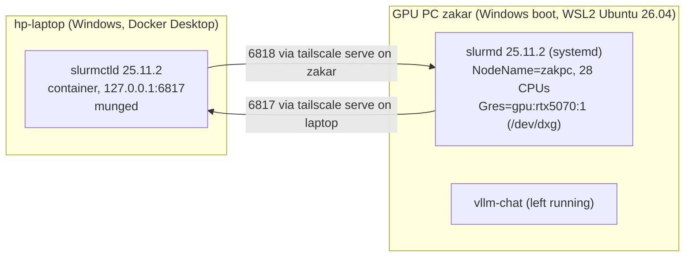

# Slurm across the homelab: laptop controller, GPU PC compute node

[gpu-systems-lab](../../README.md) / `scheduling/slurm/` · [← scheduling (k3s)](../README.md) · [Results](../../docs/RESULTS.md)

A two-machine Slurm 25.11 cluster over Tailscale. It runs this repo's existing FSDP and NCCL code
(`modal/fsdp_gpt.py`, `modal/ddp_train.py`, unchanged) as batch jobs on the RTX 5070. It's the
same queue-a-GPU problem as the [k3s setup](../README.md), solved the way HPC centres do it.

Everything below was set up and measured on 2026-11-14 (UTC). Raw job logs, result JSON and the
job-completion log are in [results/slurm/](../../results/slurm/).



| Piece | Where | Notes |
|---|---|---|
| `slurmctld` | container on the laptop ([compose.yml](compose.yml), [Dockerfile.ctld](Dockerfile.ctld)) | Ubuntu 26.04 + `slurmctld`, the same package version as the node. State in a named volume |
| `slurmd` | WSL Ubuntu on the GPU PC, systemd unit from the distro package | Config from [slurm.conf](slurm.conf) and [gres.conf](gres.conf). Jobs use a torch 2.11.0+cu128 venv in `/opt/slurm-lab` |
| Auth | MUNGE | One key, generated in the controller's volume and copied to the node over SSH. Never printed or committed |
| Network | Tailscale | Only `tailscale serve --tcp 6817` (laptop) and `--tcp 6818` (zakar) open the ports, tailnet-only. `NodeAddr` and `SlurmctldHost` are tailnet IPs |

Design choices:
- **GPU as a gres in WSL.** WSL2 has no `/dev/nvidia0`; the GPU appears as `/dev/dxg`. With
  `File=/dev/dxg`, Slurm counts one device, sets `CUDA_VISIBLE_DEVICES=0` for the job, and queues
  any second GPU job.
- **No cgroup containment** (`proctrack/linuxproc`, `task/none`). The controller container and
  WSL don't share a cgroup layout, and there's one user. On a shared cluster you'd use
  `proctrack/cgroup` + `task/cgroup` so jobs can't exceed their CPUs, memory or GPUs.
- **No slurmdbd.** `jobcomp/filetxt` writes one line per finished job, which is enough for
  submit/start/end times.
- **`DefMemPerCPU=400`.** Without a default, a job that asks for no memory gets the whole node
  and blocks every other job. The first test job did exactly that.

## What ran

Four jobs submitted back to back ([jobs/](jobs/)):

| Job | Asks for | Wait | Ran | Result |
|---|---|---:|---:|---|
| 2 `fsdp-cpu2` | 8 CPUs, 4 GB, no GPU | 0 s | 8 s | FSDP2 over **2 ranks on CPU (gloo)**: loss 7.65 → 7.13, 73 ms/step |
| 3 `fsdp-gpu` | 1 GPU, 8 CPUs, 8 GB | 9 s | 8 s | FSDP2, 33.8M-param GPT on the RTX 5070: **32.3 ms/step, 127k tok/s, 1.36 GiB peak** |
| 4 `nccl-gpu` | 1 GPU, 4 CPUs, 6 GB | 16 s | 6 s | NCCL 2.28.9 initializes under Slurm. DDP x1, 16.8M-param MLP: 1.40 ms/step, 183k samples/s |
| 5 `fsdp-gpu` | 1 GPU | 23 s | 8 s | Same as job 3: 29.5 ms/step. Final loss 6.3406 vs 6.3408 (bf16 kernels are not bit-deterministic) |

- **The GPU gres serializes GPU jobs.** Jobs 3, 4 and 5 ran one after another: job 3 waited on
  `Resources`, then 4 and 5 on `Priority` ([squeue-at-submit.txt](../../results/slurm/squeue-at-submit.txt)).
- **CPU and memory are scheduled too.** Job 3 couldn't start beside job 2. Both GPUs and CPUs were
  free, but 4 GB + 8 GB exceeds the node's 12,000 MB `RealMemory`, so it waited 9 s for job 2.
- **Scheduling overhead is small.** The next GPU job started within 1 s of the previous one ending.
- **One GPU sets limits.** The NCCL job has a single rank, so it only proves NCCL works inside a
  Slurm allocation on this node. The 2-GPU bandwidth numbers are from Modal
  ([docs/NCCL-TESTS.md](../../docs/NCCL-TESTS.md)). The FSDP GPU job is also single-rank;
  real sharding is shown by the 2-rank CPU job and by the 2x H100 runs in
  [distributed/](../../distributed/README.md).
- **It shared the GPU with vLLM.** `vllm-chat` stayed up the whole time, holding about 5.4 GB.
  The jobs were sized to fit beside it, which a real cluster would enforce with
  `--gres=gpu:...:shard` or MIG.

### Resilience: daemons restarted under a running job

Job 6 (`fsdp-long`, 1,500 steps, ~53 s):
1. 8 s after it started, `docker restart` on the controller. **slurmctld was back in 3 s** and
   reloaded the running job from its state volume.
2. Then `systemctl restart slurmd` on the node. `slurmstepd` is a separate process, so the job
   kept running.
3. The job **completed with exit 0** at step 1,500 (loss 0.38, 29.7 ms/step). No restart, no lost
   steps.

What is not covered: a node that disappears (WSL shut down or the PC rebooted). Slurm would mark
`zakpc` DOWN after `SlurmdTimeout=120` s and fail the job, unless it was submitted with `--requeue`.

## Run it

Controller, on the laptop (from this directory):

```bash
docker compose build
docker volume create slurm-homelab_munge-key
docker run --rm --entrypoint sh -v slurm-homelab_munge-key:/etc/munge homelab/slurmctld:25.11 \
  -c 'mungekey -c -f -k /etc/munge/munge.key && chown munge:munge /etc/munge/munge.key && chmod 400 /etc/munge/munge.key'
docker compose up -d
tailscale serve --bg --tcp 6817 tcp://127.0.0.1:6817
```

Node, in WSL on the GPU PC:
1. `apt install slurmd slurm-client munge`.
2. Copy `slurm.conf` and `gres.conf` to `/etc/slurm/`, and the MUNGE key to `/etc/munge/munge.key`
   (mode 400, owner munge).
3. `systemctl restart munge slurmd`.
4. On Windows: `tailscale serve --bg --tcp 6818 tcp://localhost:6818`.

Submit from the controller:

```bash
docker exec -i slurm-homelab-slurmctld-1 sbatch < jobs/fsdp_gpu.sbatch
docker exec slurm-homelab-slurmctld-1 squeue
docker exec slurm-homelab-slurmctld-1 sinfo -N -l
```

Tear down: `docker compose down -v`, `tailscale serve --tcp=6817 off` (laptop),
`tailscale serve --tcp=6818 off` and `systemctl disable --now slurmd` (node).
